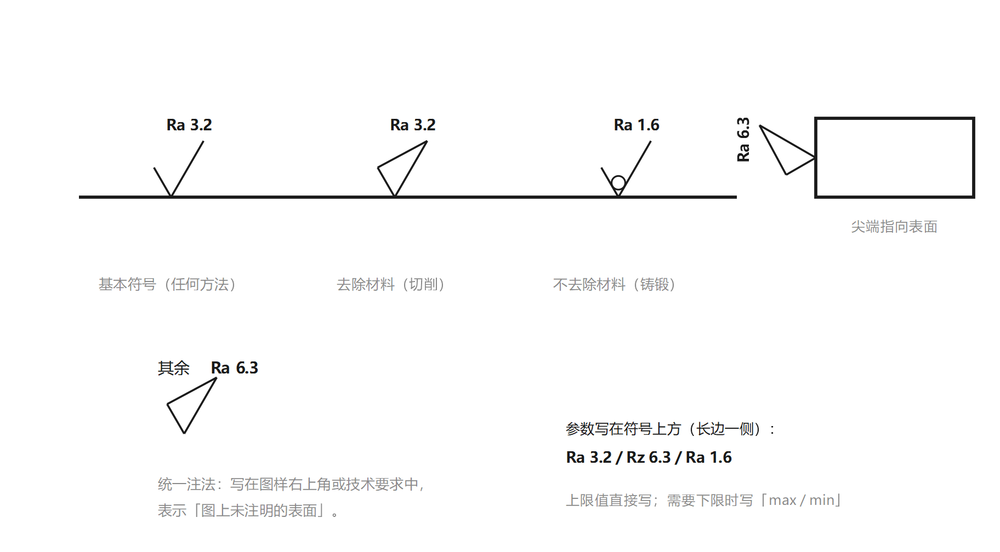

# 制图符号速补

> 本班未系统学习机械制图，本页只补**考试标注 / 改错必需**的符号与规则，不做系统制图教学。看完本页再进「标注题」与「改错题」。

## 1. 尺寸标注三要素

一个完整尺寸 = **尺寸界线 + 尺寸线 + 尺寸数字**：

- 尺寸线两端带**箭头**，指向被标注要素；
- 尺寸数字注在尺寸线上方，单位 mm **省略不写**；
- 直径加 `φ`，半径加 `R`，正方形边长加 `□`。

## 2. 公差带代号与配合代号

| 代号 | 含义 |
|---|---|
| `φ50 H8` | 孔公差带代号 = 基本偏差字母（大写）+ 公差等级数字 |
| `φ50 f7` | 轴公差带代号 = 基本偏差字母（小写）+ 公差等级数字 |
| `φ50 H8/f7` | 配合代号 = 孔公差带（分子）/ 轴公差带（分母） |

> 配合代号也可写成上下分数形式（H8 在上、f7 在下）。

- 孔用**大写**字母（H、F、G…），轴用**小写**字母（h、f、g…）；
- 字母与数字**同号大小**书写。

## 3. 形位公差框格（核心）

- **第1格**：公差项目符号（直线度 / 平面度 / 圆度 / 圆柱度 / 线轮廓度 / 面轮廓度 / 平行度 / 垂直度 / 倾斜度 / 同轴度 / 对称度 / 位置度 / 圆跳动 / 全跳动）。
- **第2格**：公差值（mm）+ 修饰符号（`φ` 圆柱、`Sφ` 球面、`Ⓜ Ⓛ Ⓔ Ⓡ Ⓟ`）。
- **第3格起**：基准字母。**第三格 = 第一基准**，第四、五格 = 第二、三基准（与字母表顺序无关）。
- 指引线从框格左端或右端引出，**弯折不超过 2 次**。

## 4. 基准符号

- 字母**大写**、**水平书写**（无论基准符号在图面上的方向如何）；
- **禁用字母**：E、I、J、M、O、P、R、F、L（共 9 个）。

## 5. 指引线箭头与基准三角形的摆放（改错重灾区）

| 被测要素类型 | 指引线箭头放置 |
|---|---|
| 轮廓要素（线 / 面） | 箭头指**轮廓线或它的延长线**，与尺寸线**明显错开** |
| 中心要素（轴线 / 中心面 / 球心） | 箭头与**尺寸线的延长线重合（对齐）** |

| 基准要素类型 | 基准三角形底边放置 |
|---|---|
| 轮廓要素 | 底边贴**轮廓线或延长线**，与尺寸线**明显错开** |
| 中心要素 | 底边贴**尺寸界线**，连线与**尺寸线对齐** |

> 一句话：**轮廓要素「错开尺寸线」，中心要素「对齐尺寸线」**。箭头总指向公差带宽度方向或直径方向。

## 6. 修饰符号表

| 符号 | 含义 | 位置 |
|---|---|---|
| `φ` | 圆柱面 / 圆公差带 | 公差值前 |
| `Sφ` | 球面公差带 | 公差值前 |
| `Ⓜ` | 最大实体要求 | 公差值后（或基准字母后） |
| `Ⓛ` | 最小实体要求 | 公差值后 |
| `Ⓔ` | 包容要求 | 尺寸后（如 φ20 Ⓔ） |
| `Ⓡ` | 可逆要求 | Ⓜ / Ⓛ 后 |
| `Ⓟ` | 延伸公差带 | 公差值后 |

## 7. 表面粗糙度（应用题必考）

> 应用标注题（滚动轴承 / 键连接）要求「尺寸公差 + 形位公差 + **表面粗糙度**」三样都标，这一节必须会。

### 7.1 三种符号（看有没有横线、有没有圆）

| 符号 | 含义 | 画法 |
|---|---|---|
| **基本符号** | 任何方法获得的表面，**不能单独使用**（必须带参数） | 一个「√」 |
| **去除材料** | 用切削、磨削等**去除材料**的方法获得 | 「√」的开口处**加一条横线**（封口） |
| **不去除材料** | 铸、锻、轧等**不去除材料**的方法获得 | 「√」中间**加一个圆** |

> 记忆：**横线 = 切掉（去除），圆圈 = 长出来（不去除）**。

### 7.2 高度参数

- **Ra**（轮廓算术平均偏差）——**优先选用**，一个数就能表达；
- **Rz**（轮廓最大高度 = Rp + Rv）——用于极光滑或极粗糙、不宜用 Ra 的表面；
- 数值取自标准系列：0.012、0.025、0.05、0.1、0.2、0.4、**0.8、1.6、3.2、6.3**、12.5、25、50……
- 旧标准的 **Ry**（轮廓最大高度）已并入 Rz；旧 Rz（十点高度）已取消——考试按新标准答。

### 7.3 标注规则（五条）

1. 符号的**尖端从材料外面指向表面**（不能指向材料内部）；
2. 画在**可见轮廓线**、**尺寸界线**或它们的**延长线**上；
3. 符号与数字的方向：**从图样下方或右方看是正的**；
4. **同一表面只标一次**；重复要素可标一处并注数量；
5. **统一注法**：图样右上角（或技术要求里）写「其余 + 符号 + 参数」，表示**所有未注明的表面**。

### 7.4 常用数值与配合精度的对应

| 尺寸公差等级 | 典型表面 | Ra（μm） |
|---|---|---|
| IT5、IT6 | 精密轴颈、量规工作面 | 0.2 ~ 0.8 |
| IT7、IT8 | 一般轴颈、箱体孔、滚动轴承配合面 | 0.8 ~ 1.6 |
| IT9 ~ IT11 | 一般非配合面、键槽底 | 3.2 ~ 6.3 |
| 未注 | 铸锻毛面、非加工面 | 12.5 ~ 50 |

### 7.5 常见错误（改错题也可能考）

| 错误 | 说明 |
|---|---|
| 符号尖端指向材料内部 | 方向反了，应**从外指向表面** |
| 只写 `3.2` 不写 `Ra` | 参数代号不能省，写 `Ra 3.2` |
| 同一表面标两处 | 只标一次，其余靠统一注法 |
| 单独使用基本符号 | 基本符号必须带参数才有意义 |
| Ra 与 Rz 混写 | 同一张图应统一用 Ra（优先） |
