# 标注题专题（25分）

> **题型（两道）**：
> - **第一道 · 10 分**：给一段技术要求，要求把**尺寸公差 + 形位公差**标注在图上（零件图）。
> - **第二道 · 15 分**：从**滚动轴承配合**、**键连接**中选一种，标注**尺寸公差 + 形位公差 + 表面粗糙度**。图可能是零件图，也可能是装配图。
>
> **声明**：「一、四」为编者自拟练习，**非老师提供**，答案可能有偏差；老师例题的图取自课件。标注规则（箭头怎么摆、φ 什么时候加）见「制图符号速补」，本页直接用。

---

# 第一部分 · 按要求标注尺寸公差和形位公差（10 分）

## 一、尺寸公差的三种写法

同一个要求，零件图上可以有三种写法（考试写哪一种都对，但**同一张图要统一**）：

| 写法 | 例子 | 用在哪 |
|---|---|---|
| 只写**公差带代号** | $\phi 50H7$、$\phi 30k6$ | 大批量、有量规检验的零件图 |
| 只写**极限偏差** | $\phi 50^{+0.025}_{0}$、$\phi 30^{\,0}_{-0.025}$ | 单件小批、零件图 |
| **代号 + 偏差** | $\phi 50H7(^{+0.025}_{0})$ | 两者都要时 |

**装配图**写**配合代号**：分子是孔、分母是轴，如 $\phi 50\dfrac{H7}{k6}$ 或写成 $\phi 50H7/k6$。

**公差原则的符号**写在尺寸后面：

- 包容要求 **Ⓔ** → $\phi 30^{\,0}_{-0.025}\ \text{Ⓔ}$；
- **独立原则是默认**，**不加任何符号**（标注题里「采用独立原则」= 什么都不标，标了反而错）。

> 记忆：**Ⓔ 跟尺寸走**（写在尺寸后），**Ⓜ / Ⓛ 跟形位公差走**（写在公差值后）。

## 二、公差项目与公差带形状速查（决定要不要加 φ）

| 项目 | 符号 | 公差带形状 | 公差值含义 | 加 φ？ |
|---|---|---|---|---|
| 直线度（给定平面） | — | 两平行直线 | 宽度 t | 否 |
| 直线度（给定方向） | — | 两平行平面 | 宽度 t | 否 |
| 直线度（任意方向） | — | 圆柱面 | 直径 φt | **是** |
| 平面度 | ◇ | 两平行平面 | 宽度 t | 否 |
| 圆度 | ○ | 两同心圆 | **半径差** t | 否 |
| 圆柱度 | ⌭ | 两同轴圆柱面 | **半径差** t | 否 |
| 线轮廓度 / 面轮廓度 | ⌒ | 两包络线 / 两包络面 | 宽度 t | 否 |
| 平行度 / 垂直度 / 倾斜度（单向） | // ⊥ ∠ | 两平行平面 | 宽度 t | 否 |
| 平行度 / 垂直度（任意方向） | // ⊥ | 圆柱面 | 直径 φt | **是** |
| 同轴度 | ◎ | 圆柱面 | 直径 φt | **恒是** |
| 对称度 | ≐ | 两平行平面 | 宽度 t | 否 |
| 位置度 | ⌖ | 圆柱面（球面加 Sφ） | 直径 φt / Sφt | **是** |
| 圆跳动 / 全跳动 | ↗ / ⌰ | 测量方向上的一段 | 宽度 t | 否 |

> **一句话**：只有 **同轴度、位置度** 恒加 φ；**直线度/平行度/垂直度在「任意方向」**时才加 φ；其余一律不加。

## 三、标注规则（浓缩版）

1. **被测要素**
   - 轮廓要素（圆柱面、平面、素线）→ 箭头指**轮廓线或其延长线**，与尺寸线**明显错开**；
   - 中心要素（轴线、中心平面、球心）→ 箭头与**尺寸线（的延长线）对齐**。
2. **基准要素**
   - 轮廓要素 → 三角形底边贴**轮廓线/延长线**，与尺寸线错开；
   - 中心要素 → 三角形底边贴**尺寸界线**，细实线与**尺寸线对齐**。
3. 基准字母**大写、水平书写**，禁用 **E、I、J、M、O、P、R、F、L**。
4. 框格**第三格 = 第一基准**，第四、五格为第二、第三基准。
5. 指引线最多弯折 **2** 次；箭头指向公差带的**宽度方向或直径方向**。
6. **面**对**轴线**只能谈垂直度/倾斜度；**线（轴线）**对**轴线**才谈平行度/同轴度。

## 四、老师例题精讲（标注题 1，10 分）

**题目**：试将下列技术要求标注在图上。

1. φd 圆柱面的尺寸为 $\phi 30^{\,0}_{-0.025}$，采用**包容要求**；φD 圆柱面的尺寸为 $\phi 50^{\,0}_{-0.039}$，采用**独立原则**；
2. 键槽侧面对 φD 轴线的**对称度**公差为 0.02 mm；
3. φD 圆柱面对 φd 轴线的**径向圆跳动**不超过 0.03 mm，轴肩端平面对 φd 轴线的**端面圆跳动**不超过 0.05 mm。

**题图**（只给尺寸，形位公差待标注）：

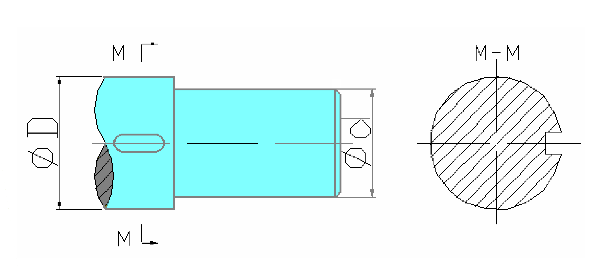

**参考答案图**（老师课件的标注结果）：

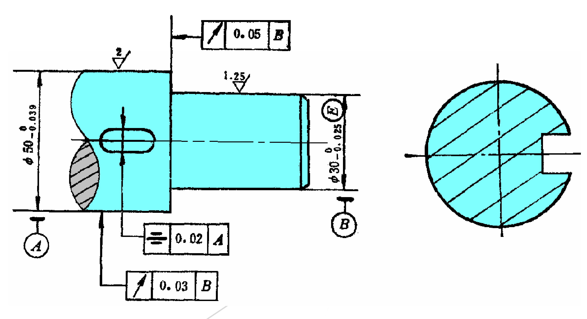

**逐条解法**：

**(1) 尺寸公差与公差原则写在尺寸后面**

- $\phi 30^{\,0}_{-0.025}$ 后加 **Ⓔ** → $\phi 30^{\,0}_{-0.025}\ \text{Ⓔ}$（包容要求）；
- $\phi 50^{\,0}_{-0.039}$ **不加任何符号**（独立原则是默认原则）。

**(2) 键槽对称度**

- 框格：`[ ≐ | 0.02 | A ]`，基准 A = φD 轴线；
- 基准 A 是**中心要素** → 三角形底边贴 φD 的尺寸界线，细实线与 **φD 尺寸线对齐**；
- 被测要素是键槽的**中心平面**（中心要素）→ 指引线箭头与**键槽宽度尺寸线对齐**。

**(3) 两个圆跳动，共用基准 B = φd 轴线**

- 径向圆跳动 `[ ↗ | 0.03 | B ]`：箭头指向 φD **圆柱面**（轮廓要素，指轮廓线）；
- 端面圆跳动 `[ ↗ | 0.05 | B ]`：箭头指向**轴肩端面**（轮廓要素）；
- 基准 B = φd 轴线 → 三角形贴 φd 尺寸界线，细实线与尺寸线对齐。

## 五、自练（尺寸公差 + 形位公差）

### 自练 1 · 阶梯轴（包容要求 + 同轴度 + 径向全跳动）

**题**：把下列技术要求标注在图上：
(1) φ40 圆柱面尺寸为 $\phi 40^{\,0}_{-0.033}$，采用**包容要求**；
(2) φ40 轴线对 φ20 轴线的**同轴度** φ0.02 mm；
(3) φ40 圆柱面对 φ20 轴线的**径向全跳动** 0.03 mm。

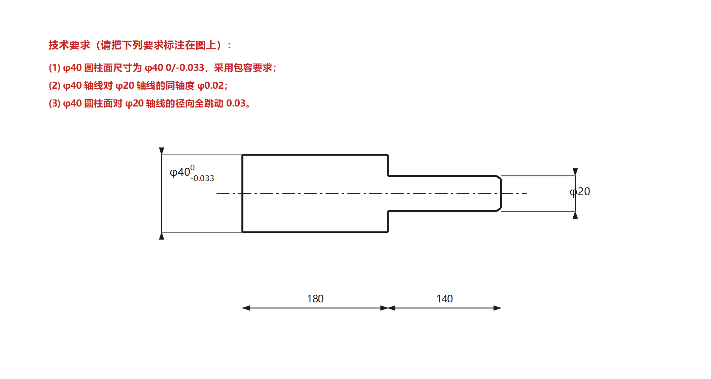

答案图（点开对照）

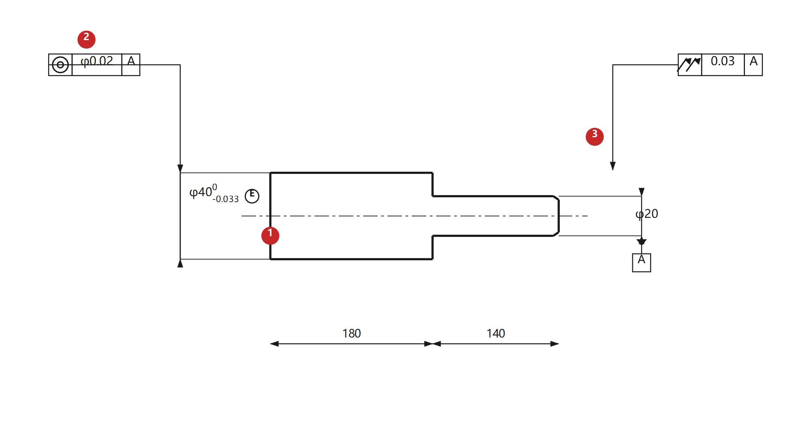

**解析**：

1. **包容要求**：在尺寸 $\phi 40^{\,0}_{-0.033}$ 后加 **Ⓔ**。含义是「实际轮廓不得超出最大实体边界 φ40」，即 **dfe ≥ φ40 且 da ≤ 40**——这样配合性质才稳定。
2. **同轴度**：`[ ◎ | φ0.02 | A ]`，被测要素是 φ40 **轴线** → 指引线**与 φ40 尺寸线对齐**；基准 A = φ20 轴线 → 三角形贴 φ20 尺寸界线、对齐尺寸线。同轴度**必须带 φ**。
3. **径向全跳动**：`[ ⌰ | 0.03 | A ]`，被测要素是 φ40 **圆柱面** → 箭头指**轮廓线**；公差带是「与基准轴线同轴、半径差 0.03 的两同轴圆柱面」，**不加 φ**。

### 自练 2 · 板件（位置度 + 三基面 + 形状公差）

**题**：把下列技术要求标注在图上：
(1) 两个 φ12 孔的位置度 φ0.1，基准 A（底面）、B（左侧面）、C（后面），定位尺寸取理论正确尺寸；
(2) 板底面平面度 0.05；
(3) 左侧面对底面 A 的垂直度 0.04。

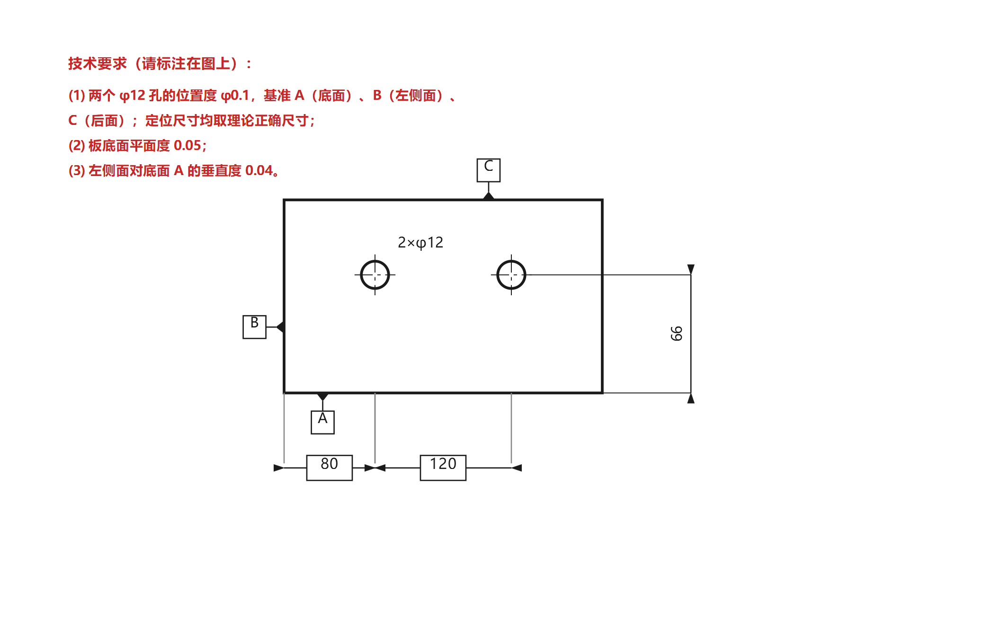

答案图（点开对照）

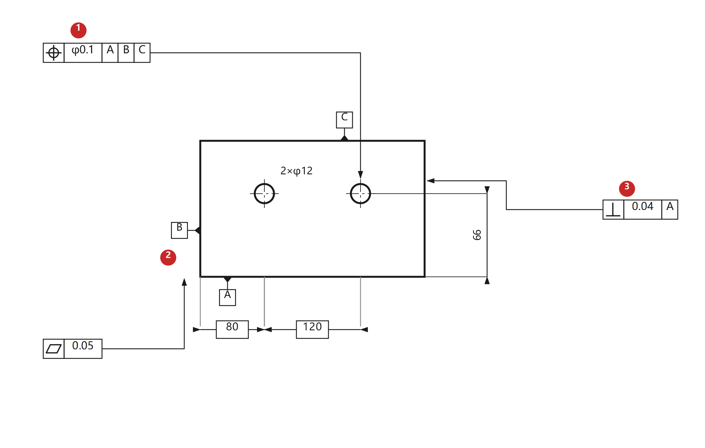

**解析**：

1. **位置度**：`[ ⌖ | φ0.1 | A | B | C ]`。三个要点：公差值**必须加 φ**；三格基准顺序 = 第一、第二、第三基准；定位尺寸（80、120、66）都是**理论正确尺寸**，要加**方框**。
2. **平面度**：`[ ◇ | 0.05 ]`，只有两格。被测要素是板底面 → 箭头贴底面轮廓线。**不加 φ、不标基准**。
3. **垂直度**：`[ ⊥ | 0.04 | A ]`。被测要素是**左侧面**（轮廓要素），基准是**底面 A**。定向公差**必须有基准**。

### 自练 3 · 套筒（包容要求 + 垂直度 + 端面圆跳动 + 圆柱度）

**题**：把下列技术要求标注在图上：
(1) 内孔 φ45 采用包容要求；
(2) 内孔轴线对左端面 A 的垂直度 φ0.02；
(3) 右端面对内孔轴线 B 的端面圆跳动 0.03；
(4) φ80 外圆柱面的圆柱度 0.01。

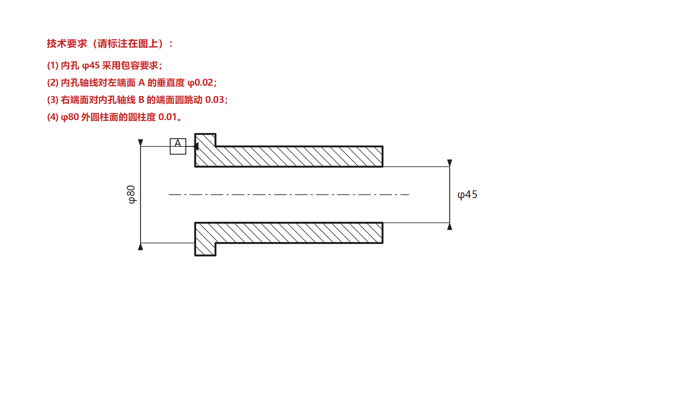

答案图（点开对照）

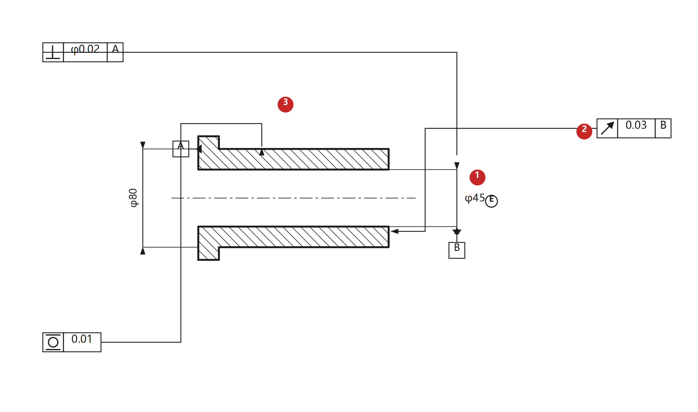

**解析**：

1. **包容要求**：在 φ45 后加 **Ⓔ**（标在内孔尺寸上）。
2. **垂直度**：`[ ⊥ | φ0.02 | A ]`。**被测要素是内孔轴线**（中心要素）→ 指引线必须**与 φ45 尺寸线对齐**；公差带是直径 φ0.02 的圆柱面 → **必须加 φ**。基准 A = 左端面。
3. **端面圆跳动**：`[ ↗ | 0.03 | B ]`。被测要素是**右端面**，箭头指在端面上；公差带沿轴向、宽度 t → **不加 φ**。基准 B = 内孔轴线。
4. **圆柱度**：`[ ⌭ | 0.01 ]`。形状公差、不涉及基准；公差带是两同轴圆柱面，**半径差**为 0.01 → **不加 φ**。

---

# 第二部分 · 应用标注（15 分，滚动轴承 / 键连接 二选一）

> 这一类题**三样都要标**：**尺寸公差（配合代号） + 形位公差 + 表面粗糙度**。少一样就丢一部分分。

## 零、先把表面粗糙度补齐（必考项）

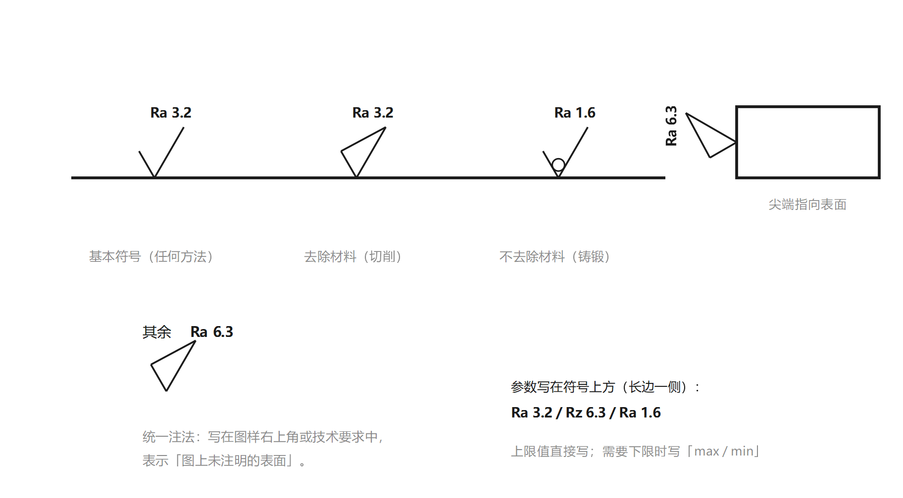

### 1. 三种符号

| 符号 | 含义 | 画法 |
|---|---|---|
| **基本符号** | 任何方法获得（**不能单独使用**） | 一个「√」 |
| **去除材料** | 切削、磨削等 | 「√」加一条横线（封口） |
| **不去除材料** | 铸、锻、轧等 | 「√」中间加一个圆 |

### 2. 高度参数写哪里

- 参数写在**符号上方（长边一侧）**，如 `Ra 3.2`、`Rz 6.3`；
- **优先用 Ra**（轮廓算术平均偏差）；Rz 用于极光滑或极粗糙、不宜用 Ra 的表面；
- 只写一个数 = **上限值**；需要下限时写成 `max` / `min` 形式。

### 3. 标注规则

1. 符号的**尖端从材料外指向表面**，画在**可见轮廓线、尺寸界线或其延长线**上；
2. 符号和数字的方向：**从图样的下方或右方看时是正的**（与尺寸数字方向一致）；
3. 同一表面**只标一次**；重复要素（如多个孔）可只标一处并注明数量；
4. **统一注法**：图样右上角（或技术要求中）写「其余 + 符号 + 参数」，表示**图上未注明的所有表面**。

### 4. 常用数值与配合精度的对应（考试够用）

| 尺寸公差等级 | 配合性质 | 常用 Ra（μm） |
|---|---|---|
| IT5、IT6 | 精密配合（轴承、精密轴颈） | 0.2 ~ 0.8 |
| IT7、IT8 | 一般配合（轴颈、箱体孔） | 0.8 ~ 1.6 |
| IT9 ~ IT11 | 一般非配合面 | 3.2 ~ 6.3 |
| 未注（自由表面） | 铸锻件毛面、非加工面 | 12.5 ~ 50 |

> 记忆：**精度越高，Ra 越小**；配合面 0.8~3.2，非配合面 6.3 起步。

---

## 一、滚动轴承配合（第 7 章）

### 1. 先分清「两侧」：轴承等级只管一侧

这是最容易糊涂的地方——**「0 级轴承」并不能唯一确定轴颈和外壳孔的公差带**，因为：

| 是谁 | 公差带由什么定 | 标注在装配图上吗 |
|---|---|---|
| **轴承这一侧**（内圈孔 / 外圈外径） | 由**轴承公差等级**定（0 级就是 0 级的那条带） | **不标**（轴承是标准件、外购件） |
| **配合件这一侧**（轴颈 / 外壳孔） | 由**负荷工况**定（下面 §2） | **要标** |

所以「0 级」只给了你两个已知条件：

1. **基准制**：内圈是「基准孔」→ 轴颈配合走**基孔制**；外圈是「基准轴」→ 外壳孔走**基轴制**；
2. **公差带位置**：0 级轴承的单一平面平均内径 $d_{mp}$、平均外径 $D_{mp}$ 偏差都是 **0 往负方向**（几微米到十几微米，随尺寸段变，具体查表），**都在零线下方**。

第 2 条的后果：同样一个 `k6` 轴，配 0 级轴承内圈会比配一个标准 H7 孔**更紧**（因为孔小了一点）。这就是教材说的「内圈配合比同名基孔制配合偏紧」。

### 2. 配合件这一侧怎么定：先看负荷类型

**判据只有一句话：套圈转不转。**

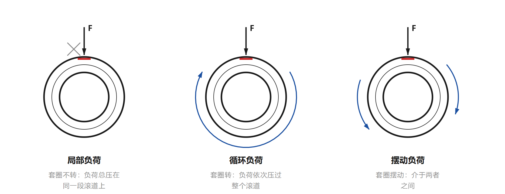

| 负荷类型 | 谁在动 | 后果 | 配合方向 |
|---|---|---|---|
| **局部负荷** | 套圈**不转**，径向负荷方向固定 → 负荷总压在同一段滚道上 | 套圈不需要「抓住」，太紧反而装拆困难 | **可松**：间隙或极小过盈 |
| **循环负荷** | 套圈**转**，负荷依次压过整个滚道 | 套圈会在配合面上**爬行**（微动磨损、发热） | **必须过盈**：靠过盈把套圈「抱死」 |
| **摆动负荷** | 套圈**摆动**，介于两者之间 | — | **过渡**：小过盈或小间隙 |

再看**负荷大小**（$P$ 为当量动负荷，$C$ 为额定动负荷）：

| 负荷大小 | 轴颈（内圈循环） | 外壳孔（外圈局部） |
|---|---|---|
| 轻负荷 $P\le0.07C$ | `j6`、`k6` | `H7`、`J7` |
| 正常负荷 $0.07C<P\le0.15C$ | **`k6`**、`m6` | **`H7`**、`J7` |
| 重负荷 $P>0.15C$ | `m6`、`n6`、`p6` | `K7`、`M7`、`N7` |

> 注意表格的方向：**「转的是谁，谁就紧」**。
> - 转轴（内圈循环）→ 轴颈紧（k6/m6）；
> - 车轮、带轮那种壳体转（外圈循环）→ 外壳孔紧（K7/M7），轴颈反而松（g6/h6）；
> - 惰轮那种内圈不动、外圈转 → 反过来选。

### 3. 还要做的三条修正

1. **过盈会吃掉游隙**：过盈太大 → 游隙过小甚至卡死；过盈太小 → 套圈爬行。选完代号要回查游隙；
2. **空心轴、薄壁壳体**：同样的过盈，变形更大 → 要适当**加大**过盈（提高一级）；
3. **转速高、温升高、装卸频繁**：转速高温升高 → 过盈适当加大；经常拆卸 → 取松一点。

### 4. 考试怎么答（最省事的路径）

题目通常只说「0 级轴承，d=φ50、D=φ90」，**没给负荷**。这时写**最常用的一对**，并补一句理由：

> 轴为**转轴**、正常负荷 → 内圈随轴转（**循环负荷**）→ 轴颈取 **k6**；
> 外圈装在静止的壳体中（**局部负荷**）→ 外壳孔取 **H7**；
> 内圈与轴颈为**基孔制**，外圈与外壳孔为**基轴制**；轴承本身是标准件，**不标等级**。

即：$\phi 50k6$、$\phi 90H7$——这就是「减速器轴 + 0 级轴承」的标准答案。

> 如果题目给了「壳体旋转」「重负荷」「空心轴」等条件，就按 §2、§3 往上调一档：外壳孔 K7/M7、轴颈 m6/n6。

### 5. 装配图标注

只标**轴颈**和**外壳孔**的公差带代号，**不标**轴承公差等级代号。例：轴颈 $\phi 50k6$、外壳孔 $\phi 90H7$。

> 公差等级：向心轴承 0、6、5、4、2（2 最高）。等级只影响**轴承自己**的公差带宽度与位置，不直接决定你选哪个轴颈代号。

### 6. 形位公差

- 轴颈、外壳孔的**圆柱度**或**圆度**：通常取 4~6 级；
- **轴颈对轴承配合面（基准轴线）的径向圆跳动**：精密场合 0.01~0.02；
- 轴肩端面对轴线的**端面圆跳动**（轴承的轴向定位面）。

### 7. 表面粗糙度

| 表面 | 与 0 级轴承配合时的 Ra |
|---|---|
| 轴颈 | **0.8 ~ 1.6**（常取 1.6） |
| 外壳孔 | **1.6 ~ 3.2**（常取 3.2） |
| 其余（轴肩、非配合面） | 6.3 |

### 自练 4（应用）· 滚动轴承装配

**题**：某减速器轴用 0 级深沟球轴承支承，内径 d = φ50、外径 D = φ90。轴为**转轴**、承受**正常负荷**，外圈装在静止的壳体中。在装配图上完成：
(1) 轴颈、外壳孔各取什么公差带？说明基准制；
(2) 轴颈对轴承配合面的径向圆跳动不超过 0.01，如何标注？
(3) 轴颈 Ra 1.6、外壳孔 Ra 3.2，其余 Ra 6.3，请标注。

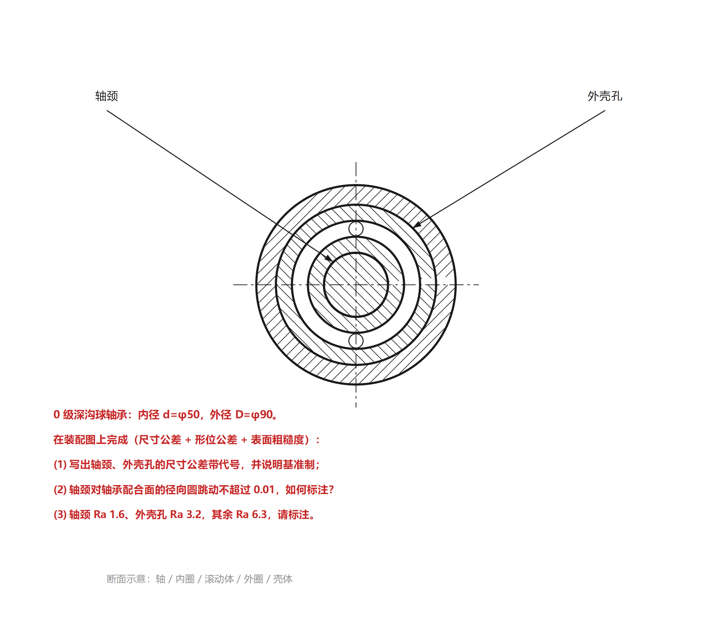

答案图（点开对照）

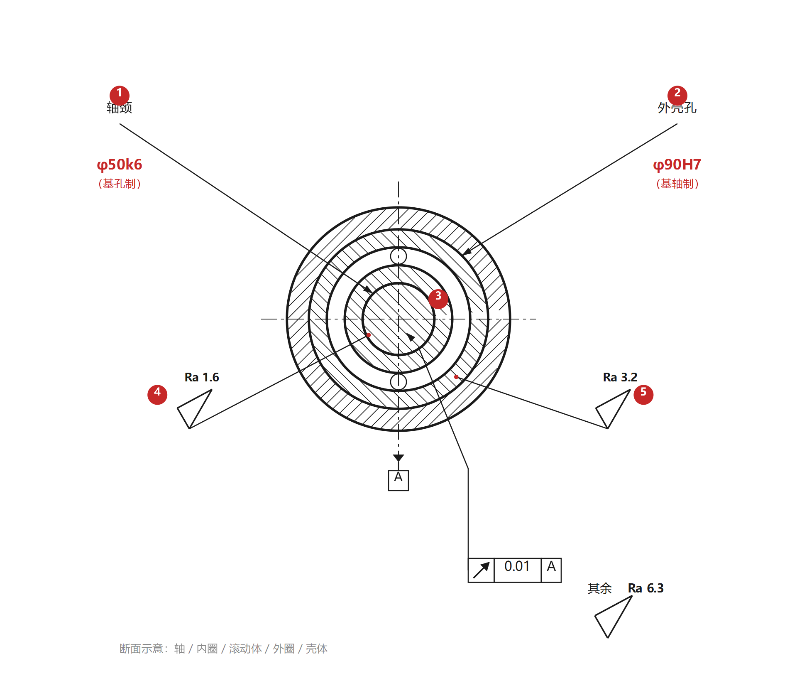

**解析**：

1. **轴颈 $\phi 50k6$**：轴是转轴 → 内圈随轴转 → **循环负荷** → 必须靠过盈抱住，正常负荷取 **k6**。基准制：内圈是基准孔 → **基孔制**。
2. **外壳孔 $\phi 90H7$**：外圈装在静止壳体中 → **局部负荷** → 可以松，取 **H7**。基准制：外圈是基准轴 → **基轴制**。
3. **装配图只标这两个代号**，不写轴承的「0 级」，也不在轴承上标配合代号。等级的作用只是让内圈公差带落在零线下方，使 `k6` 比配标准 H7 孔时**更紧**。
4. **径向圆跳动**：`[ ↗ | 0.01 | A ]`，被测要素是轴颈圆柱面（轮廓要素，箭头指轮廓线），基准 A = 轴颈轴线；跳动公差带沿径向、宽度 0.01 → **不加 φ**。
5. **表面粗糙度**：轴颈标 `Ra 1.6`（符号尖端指在轴颈表面），外壳孔标 `Ra 3.2`，右上角统一注法「其余 Ra 6.3」。

> **换个条件答案就变**：若壳体旋转（如车轮毂，外圈循环负荷）→ 外壳孔改 `K7`/`M7`，轴颈反而放松到 `g6`/`h6`；若重负荷（$P>0.15C$）→ 轴颈升到 `m6`/`n6`。**「转的是谁，谁就紧」**。

---

## 二、键连接（平键，第 11 章）

### 1. 尺寸公差（键宽配合）

- 键是**标准件**：键宽公差带 **h8**（较松联结 h9），键高 h11、键长 h14；
- 联结的**配合尺寸只有一个：宽度 b**；键高 h、槽深 t₁/t₂、键长 L 都**不是**配合尺寸；
- 键宽配合采用**基轴制**（键为「轴」）：

| 配合 | 轴槽 | 轮毂槽 | 应用 |
|---|---|---|---|
| 较松联结 | H9 | D10 | 导向平键（轮毂在轴上移动） |
| **一般联结** | **N9** | **JS9** | 载荷不大的固定联结 |
| 较紧联结 | P9 | P9 | 载荷大、有冲击、双向转矩 |

- **装配图写法**：轴槽 $\phi$/$16N9/h8$、轮毂槽 $16JS9/h8$（分子是槽、分母是键，键宽 h8 不单独标）。

### 2. 形位公差

- 键槽两侧面对轴/轮毂**轴线**的**对称度**：取 7~9 级（常见 0.02）；
- 基准 A = 轴线（中心要素）→ 基准三角形贴尺寸界线、**与尺寸线对齐**；
- 被测要素是键槽**中心平面** → 指引线与**键槽宽度尺寸线对齐**。

### 3. 表面粗糙度

| 表面 | Ra |
|---|---|
| 键槽**两侧面**（配合面）、键的两侧面 | **3.2** |
| 键槽**底面**（非配合面） | 6.3 |
| 轴、轮毂的其他表面 | 6.3 ~ 12.5 |

### 自练 5（应用）· 键连接断面

**题**：键连接（平键），轴 φ50，键 16×10，一般联结。在图上完成：
(1) 标出轴槽、轮毂槽的键宽配合代号（键宽 h8，标准件不标）；
(2) 键槽两侧面对轴线的对称度 0.02，基准 A 为轴线；
(3) 键槽侧面 Ra 3.2、槽底 Ra 6.3、其余 Ra 6.3。

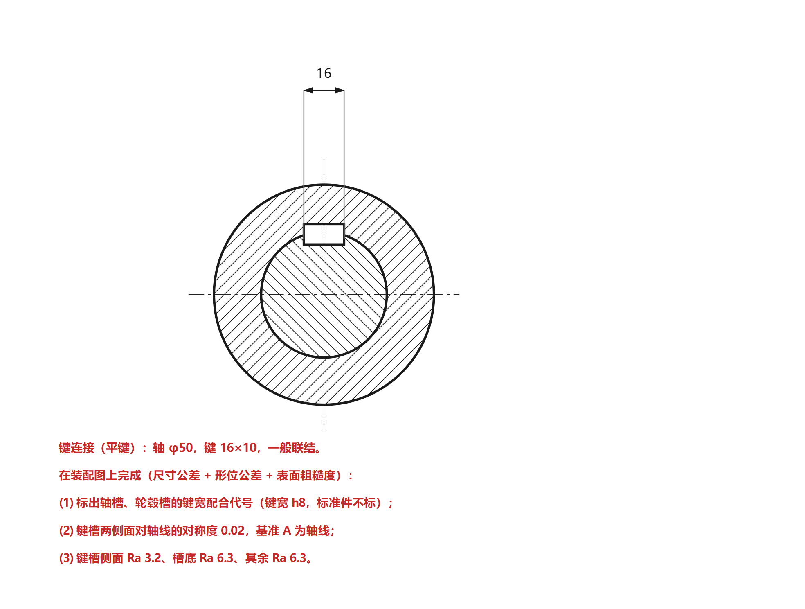

答案图（点开对照）

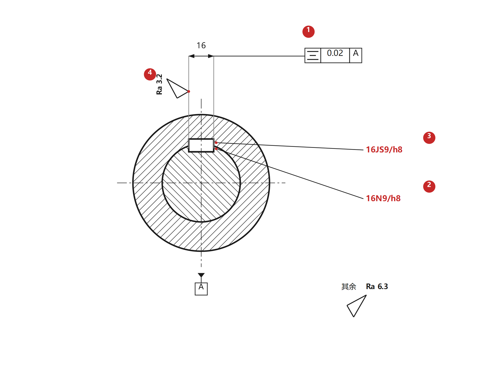

**解析**：

1. **对称度**：`[ ≐ | 0.02 | A ]`。被测要素是键槽**中心平面**，所以指引线**与键宽 16 的尺寸线对齐**（图上把尺寸线延长后接框格）；基准 A = 轴线。
2. **轴槽 16N9/h8**：分子 16N9 是**轴槽**的键宽公差带，分母 h8 是**键宽**（标准件，图上不另标）。一般联结取 N9。
3. **轮毂槽 16JS9/h8**：轮毂槽取 JS9（对称分布，便于装配对中）。
4. **表面粗糙度**：键槽**侧面**是配合面，标 `Ra 3.2`（注在尺寸界线延长线上）；**槽底**与其余表面同为 6.3，由右上角统一注法「其余 Ra 6.3」覆盖，**不必重复标**。

> **为什么槽底不单独标**：统一注法已经覆盖了所有未注表面，槽底 Ra 6.3 与「其余 6.3」相同，再标一次属于重复。

---

## 三、花键与螺纹（了解，不在本次应用范围）

考试的应用题只在**滚动轴承配合**与**键连接**中二选一，花键与螺纹了解一下即可。

### 花键（矩形花键）

- **定心方式**：**小径 d 定心**（GB/T 1144—2001）；基准制：基孔制；
- 规格标注：$N\times d\times D\times B$，如内花键 $6\times28H6\times32H10\times7H9$，外花键 $6\times28g5\times32a11\times7f7$，花键副 $6\times28\dfrac{H6}{g5}\times\ldots$；
- 几何公差：小径用**包容要求**；键宽大批量用**位置度 + 最大实体要求**，单件小批用**对称度 + 等分度**。

### 螺纹

- 标注组成：螺纹代号 + 公称直径 + 导程/螺距 + 中径公差带 + 顶径公差带 + 旋合长度 + 旋向；
- 例：$M10\text{-}6g$、$M20\times2\text{-}6H/5g6g\text{-}S$、$M14\times Ph6P2\text{-}7H\text{-}L\text{-}LH$；
- 基本偏差：内螺纹 G/H（零线上方），外螺纹 e/f/g/h（零线下方）。

---

## 四、答题格式建议

- **第一道**（尺寸公差 + 形位公差）：一处一句话，写清「标在哪、框格里写什么、基准是谁」，例如
  「φ40 后加 Ⓔ；φ40 轴线对 φ20 轴线的同轴度标 `[◎|φ0.02|A]`，基准 A 为 φ20 轴线，指引线与 φ40 尺寸线对齐」。
- **第二道**（应用，三样都要）：按 **①配合代号 → ②形位公差 → ③表面粗糙度** 的顺序写，缺一项就丢一项的分：
  1. 配合代号：写清基准制 + 代号（轴颈 φ50k6、外壳孔 φ90H7；或 16N9/h8、16JS9/h8）；
  2. 形位公差：写项目 + 公差值 + 基准（径向圆跳动 0.01 A；对称度 0.02 A）；
  3. 表面粗糙度：配合面 1.6~3.2，非配合面 6.3，别忘了统一注法「其余」。
- 别忘了 φ：**同轴度、位置度、任意方向的直线度/平行度/垂直度**——这四个地方漏 φ 是失分重灾区。
- 别忘了 Ⓔ：题目说「采用包容要求」，就必须在尺寸后加 Ⓔ；说「独立原则」，就**什么都别加**。
