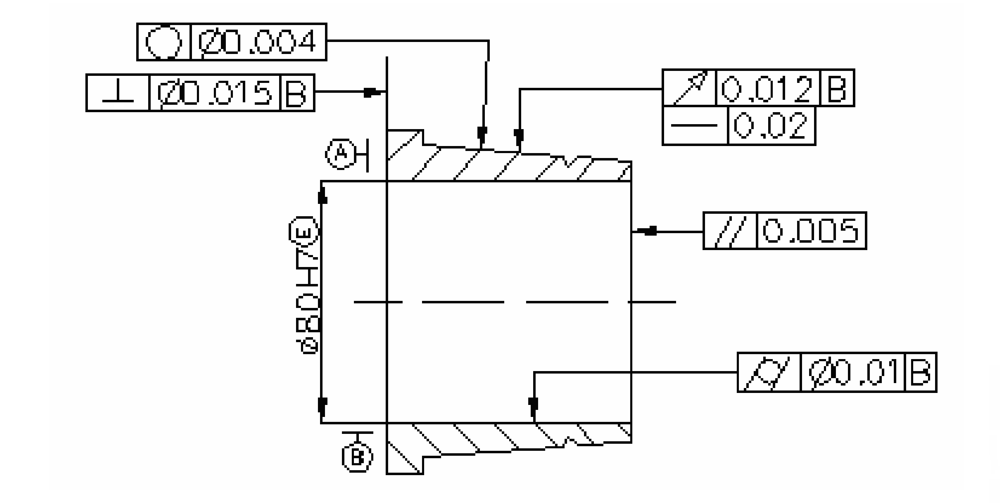
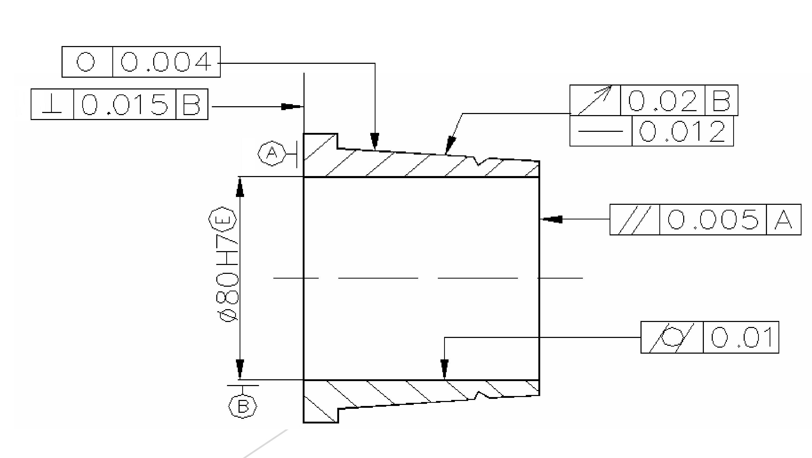
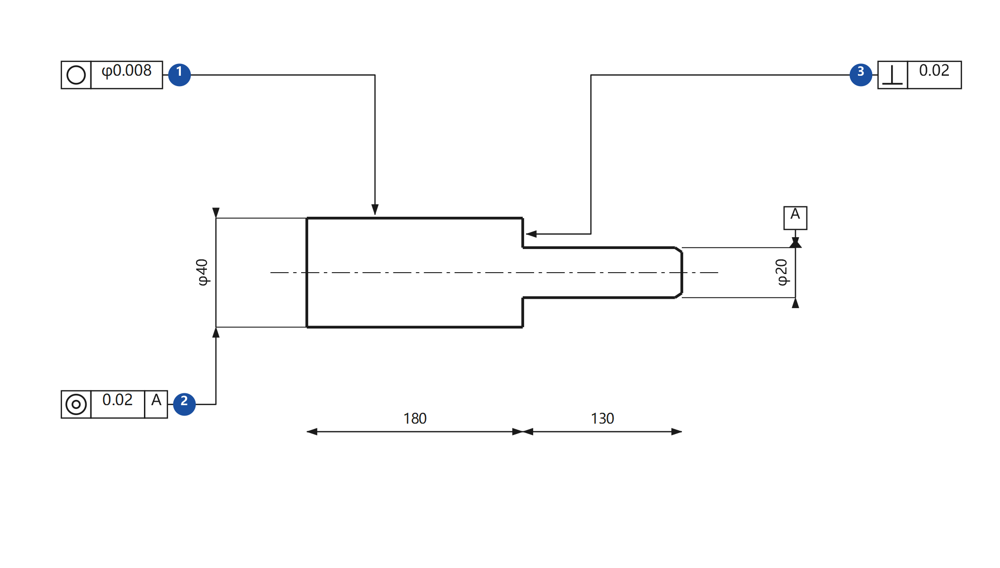
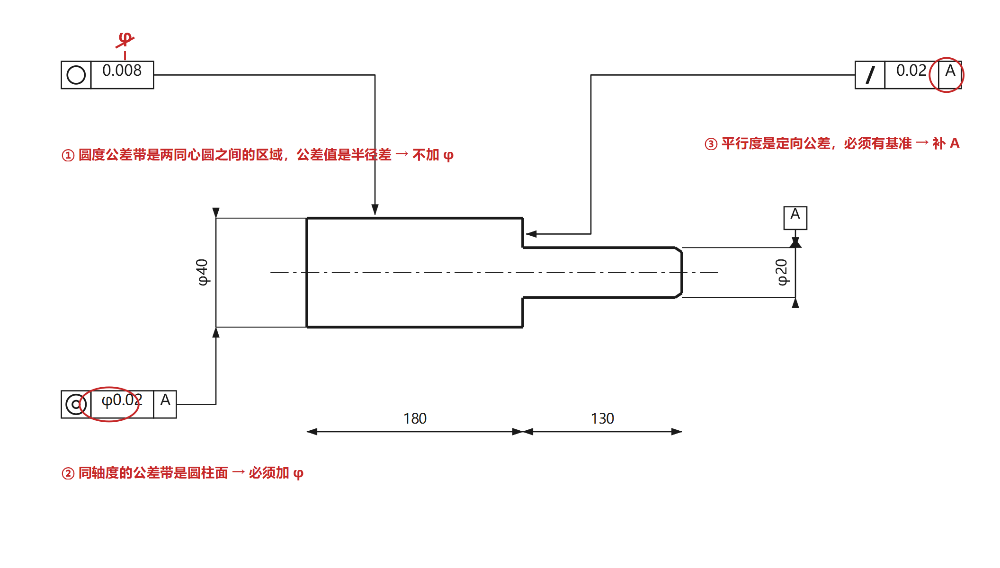
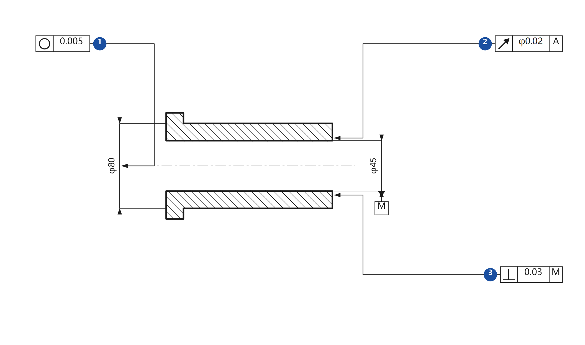
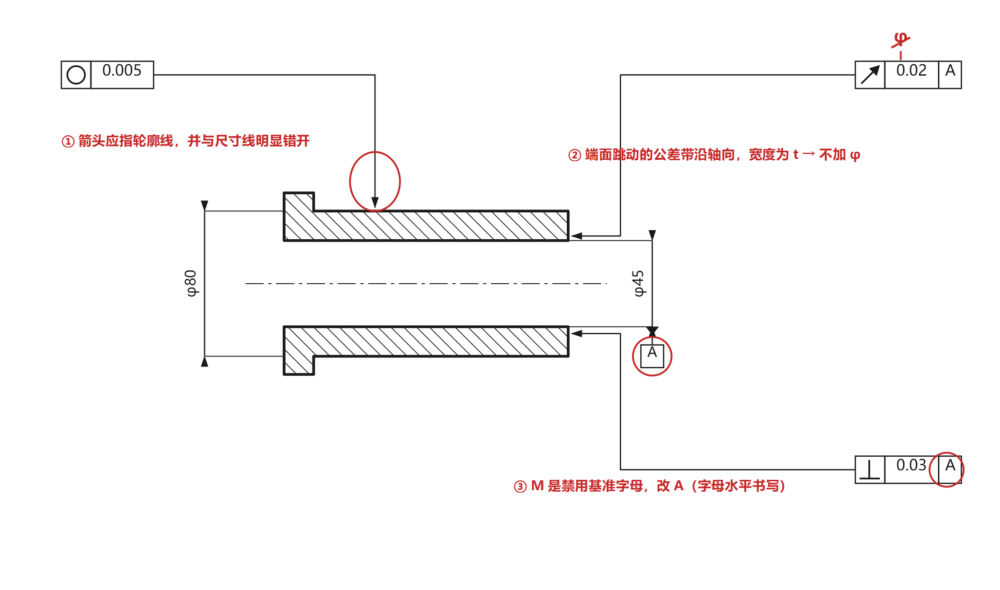
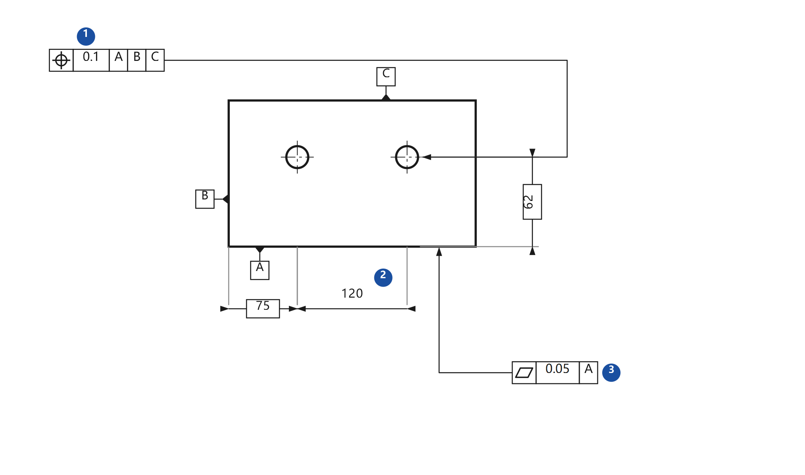
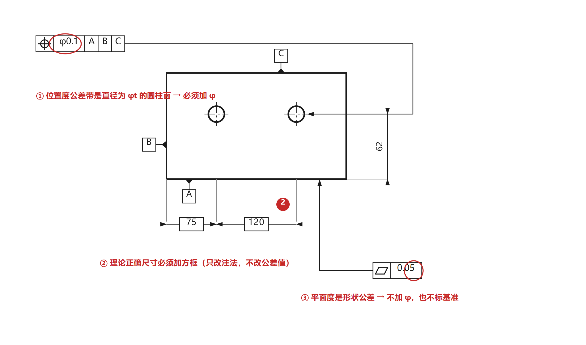
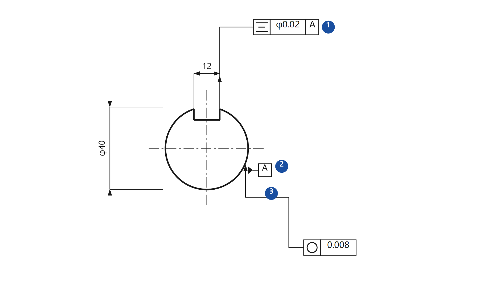
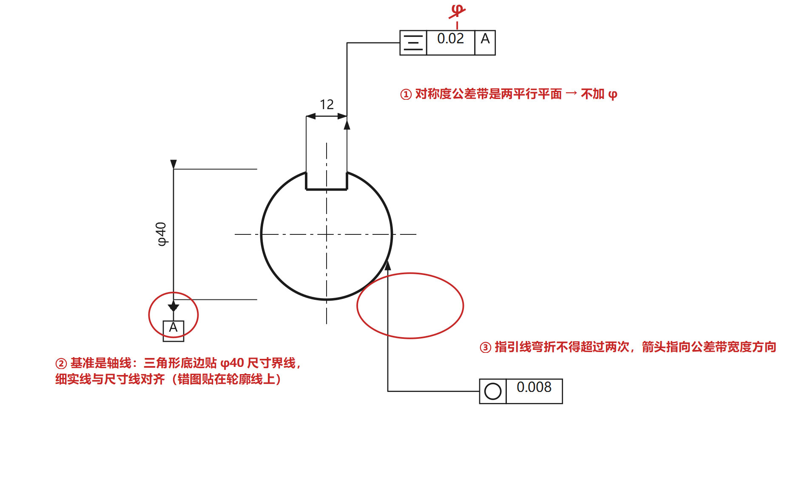

# 改错题专题（15分）

> **题型**：给一张已经标了形位公差（往往还标错）的零件图，让你指出并改正标注错误。
> **硬约束**：**不得改变形位公差项目**——只能改标注方式（加/去 φ、补/换基准字母、箭头与基准三角形的摆放、指引线走向）和符号大小关系，不能把「圆度」改成「圆柱度」，也不能改公差数值。
> **声明**：本页「一」是老师课件原题（第 2 题），图取自课件；「三、四」的自练题为编者自拟，**非老师提供**，答案可能有偏差，请以老师课堂讲法为准。

---

## 一、老师原题精讲（改错题 2）

**题目**：改正图中各项形位公差标注上的错误（不得改变形位公差项目）。

先自己数一数：图上有 **5 处** 不合规。改完再对照下面的答案图。

**答案对照——错在哪、为什么错、改成什么**：

| 编号 | 原标注 | 错在哪 | 为什么错 | 改正后 |
|---|---|---|---|---|
| ① | `○ φ0.004` | 圆度公差值前加了 φ | 圆度的公差带是**同一正截面上半径差为 t 的两同心圆**，t 就是半径差、不是直径，加 φ 就变成「直径差」了 | `○ 0.004` |
| ② | `⊥ φ0.015 B` | 垂直度公差值前加了 φ | 被测要素是**端面（轮廓要素）**，公差带是**两平行平面**、宽度为 t；只有公差带是圆柱面时才加 φ | `⊥ 0.015 B` |
| ③ | `// 0.005` | 只有两格，**没有基准** | 平行度是**定向公差**，必须有基准，否则「和谁平行」无从谈起 | `// 0.005 A` |
| ④ | `◇ φ0.01 B` | 平面度既加了 φ，又标了基准 B | 平面度是**形状公差**：公差带是两平行平面，不加 φ；形状公差**不涉及基准**，第三格根本不允许出现基准字母 | `◇ 0.01` |
| ⑤ | `↗ 0.012 B` / `— 0.02` | 圆跳动的公差值（0.012）**小于**同一要素上直线度的公差值（0.02） | 同一要素上，**形状公差必须小于位置公差**：跳动是综合控制（含形状），若形状允许 0.02，跳动却只允许 0.012，自相矛盾 | 直线度 `0.012`、圆跳动 `0.02` |

> **记忆**：①②④ 都是「**φ 该不该加**」的同一个知识点；③ 是「定向/定位必须有基准」；⑤ 是「形状 < 定向 < 定位 < 尺寸」。
> 换句话说：这道题考的不是五个孤立的知识点，而是**三条规则**——公差带形状决定 φ，公差类型决定要不要基准，公差值大小有次序。

---

## 二、高频错误清单（按出现频率排序）

### 1. φ / Sφ 用错（最高频）

| 情形 | 加不加 | 说明 |
|---|---|---|
| 同轴度、位置度（圆柱公差带） | **必须加 φ** | 公差带是直径 φt 的圆柱面 |
| 位置度（球面公差带） | **加 Sφ** | 球的直径 |
| 直线度 / 平行度 / 垂直度（**任意方向**） | **加 φ** | 此时公差带是圆柱面 |
| 直线度（给定平面/给定方向）、平面度、圆度、圆柱度、线/面轮廓度、对称度、跳动 | **不加** | 公差带是两平行直线 / 两平行平面 / 两同心圆 / 两同轴圆柱面，公差值都是**宽度或半径差** |

> 反例最常考：**圆度加 φ、对称度加 φ、平面度加 φ**（多见）；**同轴度漏 φ、位置度漏 φ**（也多见）。

### 2. 基准该不该有、写在哪个格

- **形状公差（直线度、平面度、圆度、圆柱度、线/面轮廓度无基准时）不允许有基准**，框格只有两格；
- **定向、定位、跳动公差必须有基准**：漏写基准是典型的「少一格」错误；
- 框格**第三格 = 第一基准**，第四、五格依次为第二、第三基准，**与字母顺序无关**：写了 `C A B` 就表示 C 是第一基准。

### 3. 被测要素的指引线箭头

| 被测要素 | 正确做法 | 常见错误 |
|---|---|---|
| 轮廓要素（圆柱面、平面、素线） | 箭头指**轮廓线或其延长线**，与尺寸线**明显错开** | 箭头与尺寸线对齐；箭头指到轴线 |
| 中心要素（轴线、中心平面、球心） | 箭头与**尺寸线（或其延长线）重合（对齐）** | 箭头指在轮廓线上 |

### 4. 基准符号的摆放

| 基准要素 | 正确做法 | 常见错误 |
|---|---|---|
| 轮廓要素 | 三角形底边贴**轮廓线或延长线**，与尺寸线明显错开 | 底边与尺寸线对齐 |
| 中心要素 | 三角形底边贴**尺寸界线**，细实线与**尺寸线对齐** | 底边压在轮廓线上（老师原题就是这类思路的变体） |

### 5. 基准字母本身

- 禁用 **E、I、J、M、O、P、R、F、L** 九个字母（易与尺寸偏差代号、形位符号混淆）；
- 字母一律**水平书写**，不随基准符号方向旋转；
- 字母高度与图样字体一致。

### 6. 指引线与公差值

- 指引线**弯折不超过 2 次**；
- 箭头必须指向**公差带的宽度方向或直径方向**；
- 同一要素的多项要求可以**叠放框格**共用一条指引线，但**每一项都要有自己的项目符号格**。

---

## 三、解题三步（考场上照着做）

1. **数框格、读项目**：把每个框格的**项目符号**读出来，先判断被测要素是**轮廓**还是**中心**；
2. **查 φ**：按「公差带形状」判断该不该有 φ / Sφ（这一条能抓住一半的分）；
3. **查基准与摆放**：定向/定位/跳动有没有基准？第三格是不是第一基准？箭头和基准三角形是「轮廓错开、中心对齐」吗？指引线弯折是否超过两次？最后检查**公差值大小次序**（形状 < 定向 < 定位 < 尺寸）。

> 答题格式建议：**逐条写「① 错在……，应改为……（理由一句话）」**。老师按点给分，写清编号最稳。

---

## 四、自练（4 道，编者自拟）

> 以下四道题的图为编者按考点重绘，**不是老师的原题**。做法：先只看「题图」，自己在纸上写出错误编号和改法，再展开答案图核对。

### 自练 1 · 阶梯轴（φ 与基准）

**题**：改正下图形位公差标注上的错误（不得改变形位公差项目）。

答案图（点开对照）

**解析**：

1. **`○ φ0.008` → `○ 0.008`**：圆度公差带是同一正截面上两同心圆之间的区域，公差值 0.008 是**半径差**。加 φ 后语义变成「直径差 0.008」，与定义不符。→ 去掉 φ。
2. **`◎ 0.02 A` → `◎ φ0.02 A`**：同轴度的公差带是**与基准轴线同轴、直径为 φt 的圆柱面**，公差值必须带 φ；框格第二格只有「0.02」是漏 φ。同时指引线必须与 φ40 的**尺寸线对齐**（被测要素是轴线）。
3. **`// 0.02` → `// 0.02 A`**：平行度是定向公差，**必须有基准**。被测要素是轴肩端面，基准取 φ40 轴线 A。

> 顺带记住基准 A 的标注：`A` 就是 φ20 轴线——三角形底边贴在 φ20 的**尺寸界线**上，细实线与 **φ20 尺寸线对齐**。

### 自练 2 · 套筒（箭头指向与基准字母）

**题**：改正下图标注中的错误（不得改变形位公差项目）。

答案图（点开对照）

**解析**：

1. **圆度的指引线箭头与 φ80 尺寸线对齐**：圆度被测的是 **φ80 外圆柱面（轮廓要素）**，箭头必须指在**轮廓线**上，并与尺寸线**明显错开**。对齐尺寸线是「中心要素」的画法，用错地方。
2. **`↗ φ0.02 A` → `↗ 0.02 A`**：端面圆跳动的公差带是「与基准轴线同轴的测量圆柱面上、沿母线方向宽度为 t 的一段」，公差值是**宽度 t**（沿轴向），不是直径，**不加 φ**。
3. **基准字母 `M`**：M 是**禁用字母**（E/I/J/M/O/P/R/F/L），且基准字母必须水平书写。→ 改为 A（或 B、C、D 等未禁用的字母）。

> 这三处分别对应「轮廓/中心要素的箭头摆放」「跳动的 φ」「基准字母」，是改错题最高频的三类。

### 自练 3 · 板件（位置度、理论正确尺寸、形状公差的基准）

**题**：改正下图标注及尺寸注法中的错误（不得改变形位公差项目）。

答案图（点开对照）

**解析**：

1. **`⌖ 0.1 A B C` → `⌖ φ0.1 A B C`**：位置度的公差带是**直径为 φt 的圆柱面**（孔的中心线要落在圆柱内），公差值前必须加 φ。这是「同轴度/位置度漏 φ」的典型。
2. **定位尺寸 120 没加方框**：位置度的定位尺寸是**理论正确尺寸**，不带公差，必须用**方框**（□120）；同理孔到底面的 62、到左侧面的 80 也都要加方框。注意：**只改注法，不改数值**。
3. **`◇ 0.05 A` → `◇ 0.05`**：平面度是**形状公差**，不涉及基准，框格只能两格；多写一个基准 A 属「多余的基准」。

### 自练 4 · 键槽断面（对称度与指引线）

**题**：改正下图标注中的错误（不得改变形位公差项目）。

答案图（点开对照）

**解析**：

1. **`≐ φ0.02 A` → `≐ 0.02 A`**：对称度的公差带是**相对基准中心平面对称配置的两平行平面**，公差值是两平面间的**宽度 t**，不加 φ。键槽的对称度是「键槽中心平面」对「轴线」的要求，属于典型的「中心要素对中心要素」。
2. **基准三角形贴在键槽侧面上**：对称度的基准应取 **φ40 轴线**——三角形底边贴 φ40 的**尺寸界线**、细实线与 φ40 **尺寸线对齐**，不能贴在键槽侧面上（那是轮廓要素，且不是基准要素）。
3. **指引线弯折三次**：指引线**最多弯折两次**。圆度的箭头还应指向**公差带宽度方向**（此处沿径向指在 φ40 圆柱面上）。

---

## 五、临考检查表（30 秒扫一遍）

- [ ] 每个框格第 1 格的项目符号，和题目要求**一致**（没被改动）
- [ ] 该加 φ 的加了吗（同轴度、位置度、任意方向的直线度/平行度/垂直度）？
- [ ] 不该加 φ 的去掉了吗（圆度、圆柱度、平面度、对称度、跳动、轮廓度）？
- [ ] 定向/定位/跳动有基准吗？形状公差没有多写基准吧？
- [ ] 第三格是不是第一基准？
- [ ] 基准字母避开了 E/I/J/M/O/P/R/F/L 吗？水平书写了吗？
- [ ] 箭头/基准三角形：轮廓错开、中心对齐？
- [ ] 指引线弯折 ≤ 2 次？
- [ ] 公差值大小：形状 < 定向 < 定位 < 尺寸
