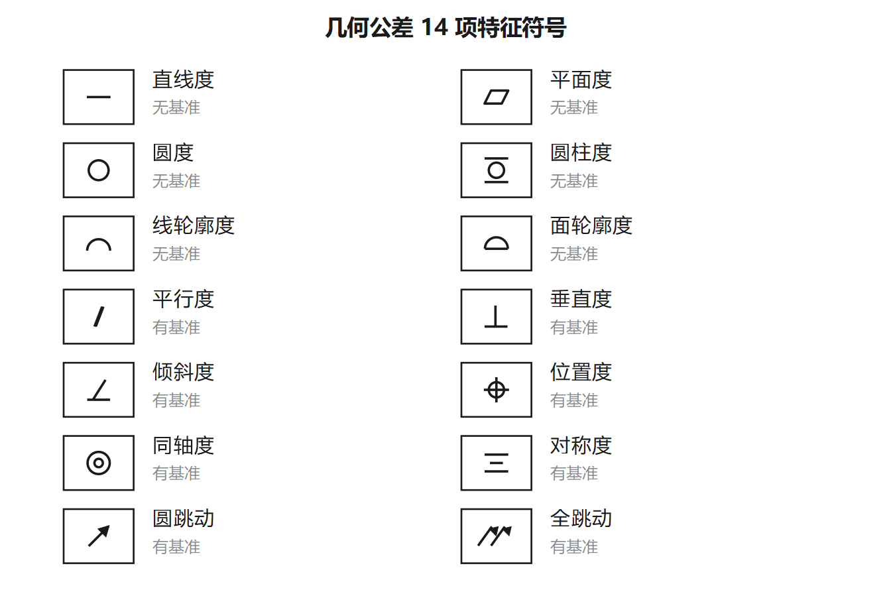
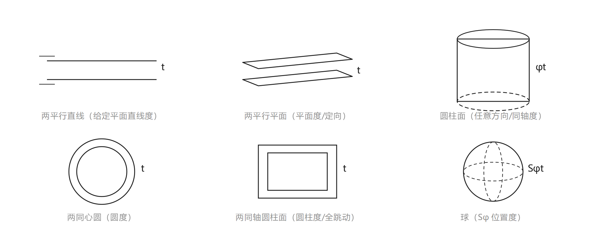

# 第四章（上）· 几何要素与公差带

> **为什么单独一章**：老师明确说第四章是本课程最重要的地方——它是「标注题 10 分 + 改错题 15 分」的全部考点来源，也是填空选择的高频区。
> **定位格式**：`〔§X P.N〕` = 本章第 X 节 · 课件 PDF 第 N 页，可回原课件核对。
> **本章结构**：§1 概述 → §2 几何公差及公差带 → §3 标注 → §4 公差原则 → §5 选择 → §6 检测。
> 本页讲 §1、§2（要素与公差带）；§4 公差原则单列一页（最重要）；§3、§5、§6 见「第四章（下）」。

---

## 一、几何要素：一切从这里开始〔§1 P.4–9〕

零件由若干点、线、面构成，这些点线面统称**几何要素**。几何公差不外乎「**拿一个要素去限制另一个要素**」，所以先要把要素分清楚。

### 1. 按「是不是真有材料」分：组成要素 / 导出要素〔§1 P.4〕

| 类别 | 又叫 | 是什么 | 例子 |
|---|---|---|---|
| **组成要素** | 轮廓要素 | 零件**表面本身**（看得见摸得着） | 圆柱面、圆锥面、球面、平面、素线 |
| **导出要素** | 中心要素 | 由轮廓**导出来的**中心点、中心线、中心面 | 轴线、中心平面、球心 |

> 判断口诀：**能用手摸到的是组成要素，摸不到的是导出要素**。
> 这一条是所有标注题的起点：**被测的是「面」还是「中心线」，决定箭头怎么摆**。

### 2. 按工作阶段分：三对范畴〔§1 P.5–6〕

| 阶段 | 显现方式 | 组成要素 | 导出要素 |
|---|---|---|---|
| 设计 | 图样 | 公称组成要素 | 公称导出要素 |
| 制造 | 工件实际存在 | 实际组成要素 | —（不存在） |
| 检验 | 对工件检测提取 | 提取组成要素 | 提取导出要素 |
| 评定 | 拟合 | 拟合组成要素 | 拟合导出要素 |

> 三范畴：设计范畴、工件范畴、检验与评定范畴。考试一般只考「提取」「拟合」这两个词属于检验/评定阶段。

### 3. 按检测时的地位分：被测要素 / 基准要素〔§1 P.7〕

- **被测要素**：图样上**给出了形状公差或位置公差**的要素；
- **基准要素**：图样上规定用来**确定被测要素方向或位置**的要素。

### 4. 按功能关系分：单一要素 / 关联要素〔§1 P.8–9〕

- **单一要素**：按本身功能给出**形状公差**的要素（只对自己有要求，不管别人）；
- **关联要素**：**对基准有功能关系**、给出**位置公差**的要素。

> 一句话：**单一要素谈形状，关联要素谈位置**。据此可直接判断框格里该不该有基准。

---

## 二、14 项几何公差：分类与符号〔§1 P.10–11〕

几何公差 = **形状公差**（6 项）+ **位置公差**（定向 3 + 定位 3 + 跳动 4，共 10 项）。注意：**线轮廓度、面轮廓度有基准要求时算位置公差**。

| 分类 | 项目 | 有无基准 | 公差带形状（核心记忆） |
|---|---|---|---|
| **形状**（6） | 直线度 | 无 | 两平行直线 / 两平行平面 / 圆柱面（任意方向） |
| | 平面度 | 无 | 两平行平面 |
| | 圆度 | 无 | 两同心圆（半径差 t） |
| | 圆柱度 | 无 | 两同轴圆柱面（半径差 t） |
| | 线轮廓度 | 无（有基准时属位置） | 两包络线 |
| | 面轮廓度 | 无（有基准时属位置） | 两包络面 |
| **定向**（3） | 平行度 | **有** | 两平行平面 / 圆柱面（任意方向） |
| | 垂直度 | **有** | 两平行平面 / 圆柱面（任意方向） |
| | 倾斜度 | **有** | 两平行平面 |
| **定位**（3） | 同轴度 | **有** | 圆柱面（**φt**） |
| | 对称度 | **有** | 两平行平面 |
| | 位置度 | **有** | 圆 / 球（Sφt）/ 圆柱 / 两平行平面 |
| **跳动**（4） | 圆跳动（径向 / 端面 / 斜向） | **有** | 测量方向上的宽度 t |
| | 全跳动（径向 / 端面） | **有** | 两同轴圆柱面 / 两平行平面 |

> **考点**：形状公差**一律无基准**；定向、定位、跳动**一律有基准**。这是改错题「多写基准 / 漏写基准」的判据。

---

## 三、公差带的四个特征〔§1 P.12–13〕

公差带不是一句空话，它有 **形状、大小、方向、位置** 四个要素——四个都答出来，才算把公差带说清楚。

### 1. 形状

常用公差带共 **11 种**形状：两平行直线、两平行平面、两等距曲线、两等距曲面、两同心圆、两同轴圆柱面、圆柱面、球、圆、一段圆锥面、一个平面。

> 记忆锚点：**形状由被测要素决定**。圆柱面 → 圆柱面或同轴圆柱面；平面 → 两平行平面；直线 → 两平行直线/平面/圆柱。

### 2. 大小

- 一般用**公差带宽度 t** 或**直径 φt** 表示；
- **只有同轴度、对称度、位置度**三项，公差值在旧国标里可表示「半径 Rt」或「宽度的一半」，现行标注**统一按 φt / t 书写**，不要被旧教材误导。

### 3. 方向

- 公差带的**延伸方向**与给定的**测量方向**垂直；
- 形状公差的方向由**最小条件**决定（浮动）；位置公差的方向由**基准**决定（固定）。

### 4. 位置

- **浮动**：在尺寸公差范围内随实际表面位置而变（形状公差带都是浮动的）；
- **固定**：由图样给定的理论正确尺寸确定（定位公差带、有基准的轮廓度）。

### 5. 理论正确尺寸〔§1 P.14〕

确定被测要素**理想形状、理想方向、理想位置**的尺寸，**不带公差**，用**加方框**的数字表示（如 □30）。

- 用于：**位置度、轮廓度、倾斜度**；
- 零件实际尺寸只由框格里的位置度/轮廓度/倾斜度公差限定；
- **标注题必考**：定位尺寸一旦用于位置度，就必须加方框。

---

## 四、形状公差逐项：公差带怎么描述〔§2 P.17–23〕

> 答题模板（背下来直接套）：**「公差带是 ______ 的区域；被测 ______ 必须位于 ______ 内。」**

### 1. 直线度（三种情况，考得最细）

| 情况 | 公差带 | 标注 | 解释 |
|---|---|---|---|
| 给定平面内 | 距离为 t 的**两平行直线** | `— 0.1` | 被测表面的素线必须位于平行于图样投影面、距离 0.1 的两平行直线内 |
| 给定方向 | 距离为 t 的**两平行平面** | `— 0.02` | 棱线必须位于箭头所指方向、距离 0.02 的两平行平面内 |
| **任意方向** | 直径为 φt 的**圆柱面** | `— φ0.04` | 被测圆柱的**轴线**必须位于直径 0.04 的圆柱面内（**要加 φ**） |

> 只有第三种加 φ。这也是「直线度要不要加 φ」的唯一判据——**看是不是任意方向**。

### 2. 平面度〔P.21〕

- 公差带：距离为 t 的**两平行平面**；
- 被测表面必须位于其间；可加**局部限制**（如「任意 100×100 范围内 0.1」）；
- **不加 φ、不标基准**。

### 3. 圆度〔P.22〕

- 公差带：**同一正截面上、半径差为 t 的两同心圆**之间的区域；
- 解释：被测圆锥（圆柱）面**任一正截面**上的圆周必须位于半径差 0.02 的两同心圆之间；
- 公差值是**半径差** → **绝对不能加 φ**。

### 4. 圆柱度〔P.23〕

- 公差带：**半径差为 t 的两同轴圆柱面**之间的区域；
- 是形状公差里**唯一综合控制**横截面圆度 + 轴向直线度 + 素线平行度的项目；
- 公差值是半径差 → **不加 φ**；
- 形状公差带的共同特点：**不涉及基准，方向和位置随实际要素浮动**。

### 5. 线轮廓度 / 面轮廓度〔P.25–28〕

- 线轮廓度：公差带是**包络一系列直径 t 的圆的两包络线**之间的区域，圆心在理想轮廓线上；
- 面轮廓度：公差带是**包络一系列直径 t 的球的两包络面**之间的区域，球心在理想轮廓面上；
- 理想轮廓的形状和位置由**基准 + 理论正确尺寸**确定；
- 面轮廓度可**同时**控制面轮廓度误差和任一截面的线轮廓度误差。

> 记忆：**线用圆包络，面用球包络**。

---

## 五、方向公差（定向）：三种项目 × 四种组合〔§2 P.30–52〕

定向公差的特点：**相对基准有确定的方向，但公差带的位置可以浮动**；并且**综合控制被测要素的方向和形状**。

### 1. 四种组合（每种项目都可能有）

| 组合 | 平行度公差带 | 垂直度公差带 | 倾斜度公差带 |
|---|---|---|---|
| **线对线** | 距离 t、平行于基准线的两平行平面 | 距离 t、垂直于基准线的两平行平面 | 与基准线成给定角度的两平行平面 |
| **线对面** | 距离 t、平行于基准平面的两平行平面 | 距离 t、垂直于基准平面的两平行平面 | 与基准面成给定角度的两平行平面 |
| **面对线** | 距离 t、平行于基准线的两平行平面 | 距离 t、垂直于基准线的两平行平面 | 与基准线成给定角度的两平行平面 |
| **面对面** | 距离 t、平行于基准平面的两平行平面 | 距离 t、垂直于基准平面的两平行平面 | 与基准面成给定角度的两平行平面 |

### 2. 给定方向 / 两垂直方向 / 任意方向

- **一个方向**：两平行平面（宽度 t）；
- **互相垂直的两个方向**：**两对**互相垂直的平行平面（t₁ 和 t₂），要标两个框格；
- **任意方向**（只有线对线、线对面可能）：公差带是**直径 φt 的圆柱面**，**要加 φ**。

> 例（课件原例）：`// φ0.03 A` —— 被测轴线必须位于**直径 0.03、且平行于基准轴线**的圆柱面内。

### 3. 倾斜度

- 公差带方向由**理论正确角度**（带方框的角度，如 □60°）确定；
- 是定向公差里唯一带「角度」的项目。

---

## 六、定位公差：位置度 / 同轴度 / 对称度〔§2 P.53–61〕

定位公差带的特点：**具有确定的位置**（相对基准的尺寸为理论正确尺寸），并且**综合控制被测要素的位置、方向和形状**。

### 1. 位置度（三种被测要素，四种公差带）

| 被测要素 | 公差带 | 加什么 |
|---|---|---|
| **点**（给定平面） | 直径 φt 的**圆** | φ |
| **点**（空间） | 直径 Sφt 的**球** | **Sφ** |
| **线**（轴线） | 直径 φt 的**圆柱面** | φ |
| **面** | 距离 t 的**两平行平面** | 不加 |

- 公差带中心点的位置由**相对基准的理论正确尺寸**确定；
- 位置度是**唯一能同时用「圆、球、圆柱、两平行平面」四种公差带**的项目。

### 2. 同轴度〔P.58–59〕

- 公差带：**直径 φt 的圆柱面**，该圆柱面与基准轴线**同轴**；
- 解释模板：「φd₁ 圆柱面轴线必须位于直径为 φ0.04、且与基准轴线 A 同轴的圆柱面内」；
- **恒加 φ**，被测要素是轴线 → 指引线与尺寸线对齐。

### 3. 对称度〔P.60–61〕

- 公差带：**距离 t、相对基准中心平面（或轴线）对称配置的两平行平面**；
- 用于控制被测**中心平面（或轴线）** 对基准中心平面（或轴线）的**共面（共线）性**；
- **不加 φ**；被测要素是中心平面 → 指引线与宽度尺寸线对齐（键槽就是典型）。

---

## 七、跳动公差：靠「测量方式」定义的一类〔§2 P.62–70〕

跳动公差的定义依赖**检测方式**：被测要素绕基准轴线回转时，指示表的最大与最小读数差。

| 项目 | 公差带 | 检测方式 |
|---|---|---|
| 径向圆跳动 | 垂直于基准轴线的**任一测量平面**内，半径差 t、圆心在基准轴线上的**两同心圆** | 工件转一周，表不动 |
| 端面圆跳动 | 与基准轴线同轴的**任一测量圆柱面**上，沿母线方向宽度 t 的一段 | 工件转一周，表不动 |
| 斜向圆跳动 | 与基准轴线同轴的**任一测量圆锥面**上，沿母线方向宽度 t 的一段 | 工件转一周，表不动（测锥面） |
| 径向全跳动 | 半径差 t、**与基准轴线同轴的两同轴圆柱面** | 工件连续旋转 + 表沿轴向移动 |
| 端面全跳动 | 距离 t、**与基准轴线垂直的两平行平面** | 工件连续旋转 + 表沿径向移动 |

> **区分圆跳动 / 全跳动**：表**不动** = 圆跳动（只反映一个截面/一条母线）；表**沿给定方向移动** = 全跳动（反映整个表面）。
> 跳动**不加 φ**（公差值是宽度或半径差）。

---

## 八、公差带的「联系与区别」（选择题爱考）〔§2 P.71〕

- **同一形状、不同项目**：下列 4 个项目的公差带**都是直径 φt 的圆柱面**——
  ① 轴线的直线度（任意方向）；② 轴线的同轴度；③ 轴线对端面的垂直度（任意方向）；④ 组孔轴线的位置度。
- **同一项目、不同形状**：
  - 直线度有 **3 种**公差带（两平行直线、两平行平面、圆柱面）；
  - 位置度有 **4 种**公差带（圆、球、圆柱、两平行平面）。
- **规律**：公差带**形状**随被测要素种类定，**方位**随被测要素相对基准的方位定，**大小**随功能与精度要求定。

---

## 九、基准：单一 / 公共 / 三基面体系〔§2 P.72–74〕

基准是确定被测要素方向或位置的参考对象，**应具有理想形状**（有时还要有理想方向）。

| 种类 | 含义 | 标注 |
|---|---|---|
| **单一基准** | 由一个要素建立的基准，按**最小条件**建立 | `A` |
| **公共基准**（组合基准） | 由两个或以上**同类**基准要素建立的一个独立基准 | `A-B`（框格中写 A-B，图上分别标 A、B） |
| **三基面体系** | 三个互相垂直的基准平面，按功能有**顺序**：第一、第二、第三基准 | 框格第三、四、五格依次填 |

> 三基面体系的顺序**与字母顺序无关**：写 `C A B` 就是 C 第一、A 第二、B 第三。

---

## 十、本章上半部分的「必背 10 条」

1. 组成要素 = 轮廓要素（摸得到）；导出要素 = 中心要素（摸不到）。
2. 单一要素谈形状（无基准），关联要素谈位置（有基准）。
3. 14 项：形状 6、定向 3、定位 3、跳动 4；轮廓度有基准时归位置公差。
4. 公差带四特征：形状、大小、方向、位置。
5. 公差带形状由**被测要素**定，方向由**基准/最小条件**定。
6. 只有**同轴度、位置度**恒加 φ；直线度/平行度/垂直度**任意方向**时加 φ。
7. 圆度、圆柱度的公差值是**半径差**；平面度、对称度、跳动是**宽度**——都不加 φ。
8. 位置度 4 种公差带：圆、球（Sφ）、圆柱（φ）、两平行平面。
9. 跳动看**表动不动**：不动 = 圆跳动，移动 = 全跳动。
10. 理论正确尺寸**加方框**，用于位置度、轮廓度、倾斜度。
