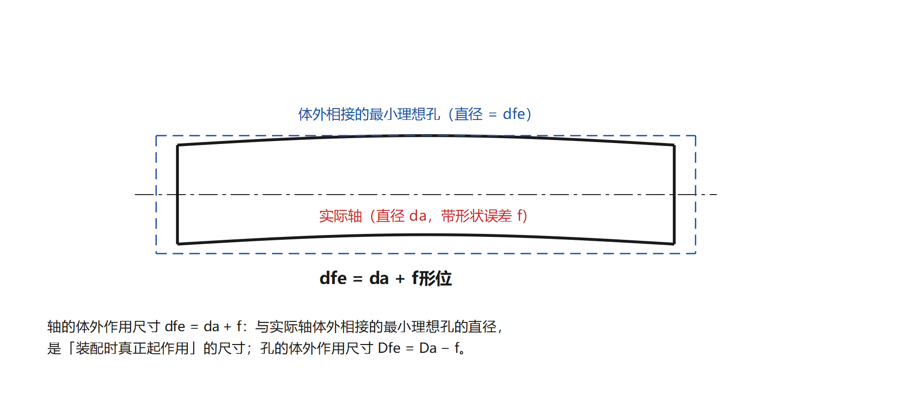
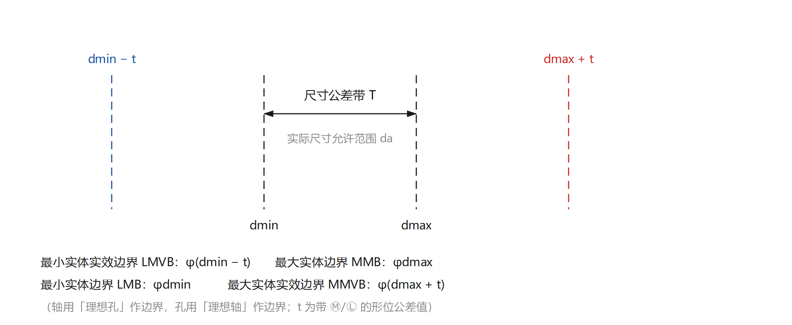
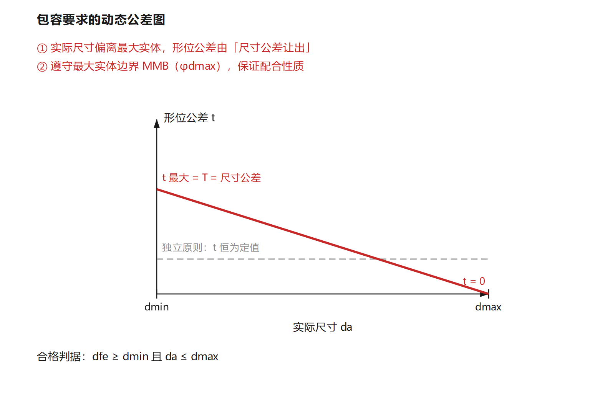
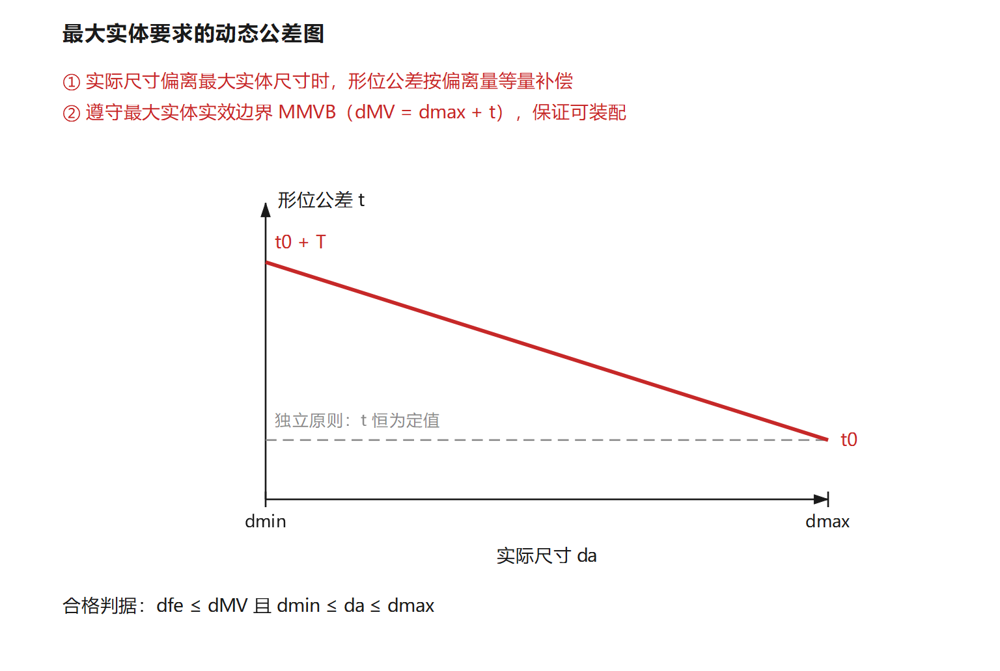
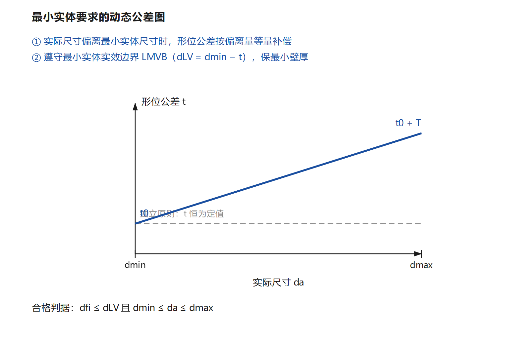

# 第四章（中）· 公差原则（本章最难、最爱考）

> **老师原话**：第四章是本课程最重要的地方；而公差原则是第四章的重点和难点。
> 课件原话：「重点：独立原则、包容要求和最大实体要求的含义；难点：包容要求和最大实体要求的应用。」〔§4 P.101〕
> **定位格式**：`〔§4 P.N〕` = 第 4 章第 4 节 · 课件 PDF 第 N 页。

---

## 一、为什么要有「公差原则」

同一被测要素往往**既给尺寸公差、又给形位公差**。两者是什么关系？——这就是公差原则要回答的问题。
处理得好，可以**把尺寸公差「让」给形位公差**，在不增加成本的前提下保证装配；处理不好，要么装配不上，要么加工不出来。

公差原则的分类〔§4 P.102〕：

```
公差原则
├── 独立原则（默认，无符号）
└── 相关原则（又称相关要求）
    ├── 包容要求 Ⓔ
    ├── 最大实体要求 Ⓜ（可加可逆要求 Ⓡ）
    └── 最小实体要求 Ⓛ（可加可逆要求 Ⓡ）
```

---

## 二、五个基本尺寸概念（全部计算的地基）〔§4 P.104–115〕

### 1. 提取局部尺寸（实际尺寸）da / Da

加工后测得的实际尺寸。**注意是「局部」尺寸**：同一要素不同位置测得的实际尺寸可能不同。

### 2. 体外作用尺寸 dfe / Dfe —— **对配合起作用**的尺寸

> 在被测要素的给定长度上，与实际**外表面（轴）体外相接的最小理想孔**、或与实际**内表面（孔）体外相接的最大理想面**的直径。

公式（**必背**）：

$$d_{fe}=d_a+f_{形位}\qquad D_{fe}=D_a-f_{形位}$$



**为什么它对配合起作用**：装配时真正「卡住」的不是实际尺寸，而是这个外接理想面的直径。所以**配合性质由 dfe / Dfe 决定**，而不是由 da 决定。

> 对**关联要素**，该理想面的轴线还必须与基准保持图样给定的几何关系（课件 P.106–107）——这是「关联体外作用尺寸」。

### 3. 体内作用尺寸 dfi / Dfi —— **对强度起作用**的尺寸

$$D_{fi}=D_a+f_{形位}\qquad d_{fi}=d_a-f_{形位}$$

用来判断**最小壁厚 / 最小实体**是否够（最小实体要求用它）。

### 4. 最大 / 最小实体状态与尺寸

| 概念 | 含义 | 轴 | 孔 |
|---|---|---|---|
| **最大实体状态 MMC** | 材料量**最多**的状态 | $d_M=d_{max}$ | $D_M=D_{min}$ |
| **最大实体尺寸 MMS** | MMC 对应的极限尺寸 | $d_M=d_{max}$ | $D_M=D_{min}$ |
| **最小实体状态 LMC** | 材料量**最少**的状态 | $d_L=d_{min}$ | $D_L=D_{max}$ |
| **最小实体尺寸 LMS** | LMC 对应的极限尺寸 | $d_L=d_{min}$ | $D_L=D_{max}$ |

> 记忆：**轴的最大实体是最大尺寸，孔的最大实体是最小尺寸**——因为「材料最多」对轴是更粗、对孔是更小。

### 5. 最大 / 最小实体实效状态与尺寸

**实效状态** = 处于实体极限状态、**且**形位误差刚好等于图样标注公差时的**综合极限状态**。

$$d_{MV}=d_{max}+t \qquad D_{MV}=D_{min}-t \quad(\text{带 Ⓜ 的 } t)$$

$$d_{LV}=d_{min}-t \qquad D_{LV}=D_{max}+t \quad(\text{带 Ⓛ 的 } t)$$

> 注意三条课件强调（P.114）：
> ① 实体状态**只要求尺寸**达到极限，不要求形状理想；
> ② 实体实效状态**只要求实效尺寸**，也不要求形状理想；
> ③ 最大实体状态与最大实体实效状态由**带 Ⓜ 的形位公差值**联系；最小实体状态与最小实体实效状态由**带 Ⓛ 的**联系。

### 6. 四种边界〔§4 P.115〕

边界 = 设计给定的、**具有理想形状**的极限包容面。**孔的理想边界是理想轴，轴的理想边界是理想孔。**

| 边界 | 尺寸（轴） | 尺寸（孔） | 对应公差原则 |
|---|---|---|---|
| 最大实体边界 **MMB** | $d_{max}$ | $D_{min}$ | 包容要求 Ⓔ |
| 最小实体边界 **LMB** | $d_{min}$ | $D_{max}$ | —（最小实体本身） |
| 最大实体实效边界 **MMVB** | $d_{max}+t$ | $D_{min}-t$ | 最大实体要求 Ⓜ |
| 最小实体实效边界 **LMVB** | $d_{min}-t$ | $D_{max}+t$ | 最小实体要求 Ⓛ |



---

## 三、独立原则〔§4 P.117–121〕

### 1. 含义

图样上给定的**尺寸公差与形位公差互不相干**：尺寸公差只管尺寸，形位公差只管形位。

### 2. 标注

**不加注任何符号**（默认原则）。所以标注题里「采用独立原则」的正确做法是——**什么都不标**。

### 3. 职能

- 尺寸公差**只**控制实际尺寸的变动量，**不**控制形状误差；
- 形位公差**只**控制形位误差，**与**实际尺寸**无关**；
- **只有两者都合格，零件才合格**（课件 P.119：其中一个不合格，零件就不合格）；
- 检测：一般用**通用量具**分别测量。

### 4. 适用场合

1. 尺寸公差与形位公差需要**分别满足要求**、两者不发生联系的要素；
2. 尺寸精度与形位精度**要求相差较大**（如印刷机滚筒：严格的圆柱度 t + 较大的尺寸公差）；
3. 保证**运动精度、密封性**、未注公差等场合；
4. **大型零件**不易采用边界控制 → 用独立原则。

---

## 四、包容要求 Ⓔ〔§4 P.122–130〕

### 1. 含义

**实际要素处处不得超出最大实体边界（MMB）**。也就是：

- 轴：$d_{fe}\le d_{max}$，且 $d_a\ge d_{min}$
- 孔：$D_{fe}\ge D_{min}$，且 $D_a\le D_{max}$

> 通俗理解：**尺寸做大了（轴）/做小了（孔），形状就必须更好**；形状误差「吃掉」的余量，必须由尺寸公差让出来。这样**配合性质（间隙/过盈）才不被形状误差破坏**。

### 2. 标注

在**尺寸后面**加圆圈 E：$\phi 20^{\,0}_{-0.021}\ \text{Ⓔ}$。

### 3. 动态公差图



- 实际尺寸 = 最大实体尺寸时，**形位公差为 0**（形状必须理想）；
- 实际尺寸偏离最大实体越多，形位公差越大；
- 最大可达 **T（= 尺寸公差）**，此时实际尺寸处于最小实体尺寸。

### 4. 例题（课件 P.130 原题）

> 按 $\phi 50^{+0.039}_{0}\ \text{Ⓔ}$ 加工一个孔，加工后测得 $D_a=\phi 50.02$，轴线直线度误差 $f=\phi 0.01$，判断该孔是否合格？

解：$D_{max}=\phi 50.039$，$D_{min}=\phi 50$。

$$D_{fe}=D_a-f=50.02-0.01=\phi 50.01$$

- $D_{fe}=50.01\ge D_M=D_{min}=\phi 50$ ✓（不超出最大实体边界）
- $D_a=50.02\le D_L=D_{max}=\phi 50.039$ ✓

**→ 合格。**

> 换个问法：若 $D_a=50.02$ 而 $f=0.03$，则 $D_{fe}=49.99<50$，**不合格**（虽然尺寸本身在公差内）。

### 5. 应用与检测

- **应用**：有**配合性质要求**的要素（如与滚动轴承配合的轴颈、有间隙要求的滑动轴承）；
- **检测**：一般用**光滑极限量规**（通规控作用尺寸、止规控实际尺寸）。

---

## 五、最大实体要求 Ⓜ〔§4 P.131–147〕

### 1. 含义

**实际轮廓不得超出最大实体实效边界（MMVB）**：当实际尺寸偏离最大实体尺寸时，**形位公差按偏离量等量增大**（补偿）。

- 轴：$d_{fe}\le d_{MV}=d_{max}+t$，且 $d_{min}\le d_a\le d_{max}$
- 孔：$D_{fe}\ge D_{MV}=D_{min}-t$，且 $D_{min}\le D_a\le D_{max}$

### 2. 标注

- 用于**被测要素**：公差值后加 Ⓜ，如 `◎ φ0.015 Ⓜ`；
- 用于**被测要素和基准要素**：公差值后 Ⓜ、基准字母后也加 Ⓜ，如 `◎ φ0.1 Ⓜ A Ⓜ`。

### 3. 动态公差图



- 实际尺寸 = 最大实体尺寸时，形位公差 = **t0（图样给定值）**；
- 实际尺寸偏离到最小实体尺寸时，形位公差 = **t0 + T**。

### 4. 例题 A（关联要素，课件 P.137 原题）

> 轴 $\phi 12^{\,0}_{-0.05}$，标注 `◎ φ0.04 Ⓜ A`。求它应满足的要求。

解：$d_M=12$，$d_L=11.95$，$T=0.05$，$t=0.04$。

1. 实际尺寸：$11.95\le d_a\le 12$；
2. 不超出**关联最大实体实效边界**：$d_{fe}\le d_{MV}=12+0.04=12.04$；
3. 当轴处于**最小实体状态**（$d_a=11.95$）时，同轴度误差允许达到最大值
   $$t_{max}=0.04+0.05=0.09$$

> 这就是「Ⓜ 的经济性」：把尺寸公差里用不完的部分，转给形位公差。

### 5. 例题 B（零形位公差，课件 P.138）

- 标注形式：`⌖ φ0 Ⓜ` 或 `⊥ 0 Ⓜ`——**公差值为零**，但带 Ⓜ；
- 含义：**最大实体状态下形位误差必须为 0**；实际尺寸偏离最大实体后，形位公差才按偏离量放宽。
- 用途：**只要求可装配性、不需要形状精度**的场合，等于「把尺寸公差全部当形位公差用」。

### 6. 可逆要求 ⓂⓇ（课件 P.146–147）

**可逆**：不仅尺寸偏离可以补偿形位，**形位误差小于给定值时，也允许实际尺寸超出最大实体尺寸**（但不得超出最大实体实效尺寸）。

> 例（P.147）：轴 $\phi 20^{\,0}_{-0.3}$，标注 `— φ0.1 ⓂⓇ`。
> - $d_M=20$、$d_L=19.7$、$T=0.3$、$t=0.1$、$d_{MV}=20.1$；
> - 实际尺寸到最小实体 $19.7$ 时，直线度可达 $0.1+0.3=0.4$；
> - 直线度误差为 0 时，实际尺寸可到 $d_{MV}=20.1$，即**尺寸公差可放大到 0.4**。

### 7. 应用

- 用于**中心要素**，一般用于**仅要求可装配性、无严格对中要求**的场合（如螺栓通孔、法兰孔的位置度）；
- 检验：用**位置量规**（控制实效边界）。

---

## 六、最小实体要求 Ⓛ〔§4 P.148–155〕

### 1. 含义

**实际轮廓不得超出最小实体实效边界（LMVB）**：当实际尺寸偏离**最小实体尺寸**时，形位公差按偏离量等量增大。

- 轴：$d_{fi}\ge d_{LV}=d_{min}-t$，且 $d_{min}\le d_a\le d_{max}$
- 孔：$D_{fi}\le D_{LV}=D_{max}+t$，且 $D_{min}\le D_a\le D_{max}$

> 方向别记反：轴的**体内**作用尺寸不能**小于**最小实体实效尺寸（材料被挖穿），孔的不能**大于**（壁被挖薄）。

### 2. 标注

公差值后加 Ⓛ，如 `⌖ φ0.4 Ⓛ A`；也可加可逆要求 ⓁⓇ。



### 3. 例题（课件 P.152 原题）

> 孔 $\phi 8^{+0.25}_{0}$，标注 `⌖ φ0.4 Ⓛ A`。求它应满足的要求。

解：$D_M=8$，$D_L=8.25$，$T=0.25$，$t=0.4$。

1. 实际尺寸：$8\le D_a\le 8.25$；
2. 不超出**关联最小实体实效边界**：$D_{fi}\le D_{LV}=8.25+0.4=8.65$；
3. 当孔处于**最大实体状态**（$D_a=8$）时，位置度误差允许达到最大值
   $$t_{max}=0.4+0.25=0.65$$

> **为什么要用 Ⓛ**：它保证的是**最小壁厚 / 最小强度**（材料不能被形位误差「挖」得太薄），典型用于**薄壁孔、螺栓孔边缘、铸件**。

---

## 七、五种要求一张表（对比记忆）

| 项目 | 符号 | 遵守的边界 | 形位公差 | 合格判据（轴 / 孔） | 用途 |
|---|---|---|---|---|---|
| **独立原则** | 无 | 无边界要求 | 固定 = t | $d_{min}\le d_a\le d_{max}$ 且 $f\le t$ | 无配合要求、需分别满足 |
| **包容要求** | Ⓔ | 最大实体边界 MMB | 0 ~ T（变） | $d_{fe}\le d_{max}$ 且 $d_a\ge d_{min}$ / $D_{fe}\ge D_{min}$ 且 $D_a\le D_{max}$ | **保证配合性质** |
| **最大实体要求** | Ⓜ | 最大实体实效边界 MMVB | t0 ~ t0+T（变） | $d_{fe}\le d_{max}+t$ / $D_{fe}\ge D_{min}-t$ | **保证可装配性** |
| **最小实体要求** | Ⓛ | 最小实体实效边界 LMVB | t0 ~ t0+T（变） | $d_{fi}\ge d_{min}-t$ / $D_{fi}\le D_{max}+t$ | **保证最小壁厚/强度** |
| **可逆要求** | ⓂⓇ / ⓁⓇ | 同 Ⓜ / Ⓛ | 双向可调 | 同上，且尺寸可超出实体尺寸、不超实效尺寸 | 尺寸/形位都吃满 |

> **三句话记牢**：
> ① 包容要求保**配合**（边界是 MMB，尺寸与形状互相顶牛）；
> ② 最大实体要求保**装配**（边界是 MMVB，尺寸让给形位）；
> ③ 最小实体要求保**强度**（边界是 LMVB，形位让给尺寸）。

---

## 八、解题套路（考场四步）

**题型 1：给标注 + 给实测值，判断合格与否**

1. 读出 $d_{max}, d_{min}$（或 $D_{max}, D_{min}$）；
2. 按符号算边界：Ⓔ→ MMB；Ⓜ→ MMVB；Ⓛ→ LMVB；
3. 算作用尺寸：轴 $d_{fe}=d_a+f$；孔 $D_{fe}=D_a-f$（Ⓛ 用 $D_{fi}=D_a+f$）；
4. 双条件判定：**作用尺寸不越界** + **实际尺寸在公差内** → 合格。

**题型 2：给标注，求形位公差的最大允许值**

- Ⓔ：$t_{max}=T$
- Ⓜ：$t_{max}=t_0+T$（出现在**最小实体**状态）
- Ⓛ：$t_{max}=t_0+T$（出现在**最大实体**状态）
- ⓂⓇ：$t_{max}=t_0+T$，且尺寸最大可到 $d_{MV}$，**尺寸公差也可放大到 $T'=t_0+T$**

**题型 3：给图样，写标注**

- 有配合要求 → 尺寸后加 **Ⓔ**；
- 只要求装配（如螺栓孔位置度）→ 公差值后加 **Ⓜ**；
- 要保最小壁厚 → 公差值后加 **Ⓛ**。

---

## 九、易错点清单（选择/填空重灾区）

1. **「最大实体尺寸」≠「最大尺寸」**：轴的最大实体尺寸 = $d_{max}$，孔的 = $D_{min}$。
2. **作用尺寸两个方向别记反**：轴 $d_{fe}=d_a+f$（变大），孔 $D_{fe}=D_a-f$（变小）。
3. **独立原则不加任何符号**——标注题里写「采用独立原则」，图上就是**什么都不标**。
4. **Ⓔ 写在尺寸后，Ⓜ/Ⓛ 写在公差值后**（也可写在基准字母后）。
5. **包容要求用光滑极限量规检**，最大实体要求用**位置量规**检，独立原则用**通用量具**检。
6. **Ⓜ 用于中心要素**；形状公差（如平面度）用 Ⓜ 是没有意义的（没有「可装配性」可言）。
7. **可逆要求不能单独使用**，必须跟在 Ⓜ 或 Ⓛ 之后（写作 ⓂⓇ、ⓁⓇ）。
8. 零形位公差（`φ0 Ⓜ`）**不是**没有公差，而是「最大实体状态下形位误差必须为 0」。
